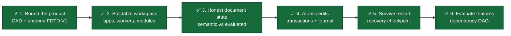
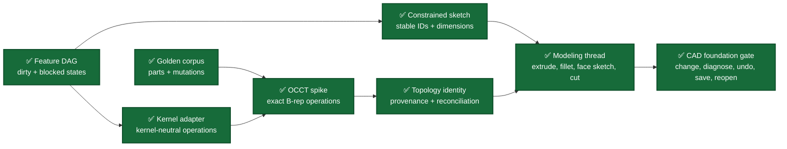
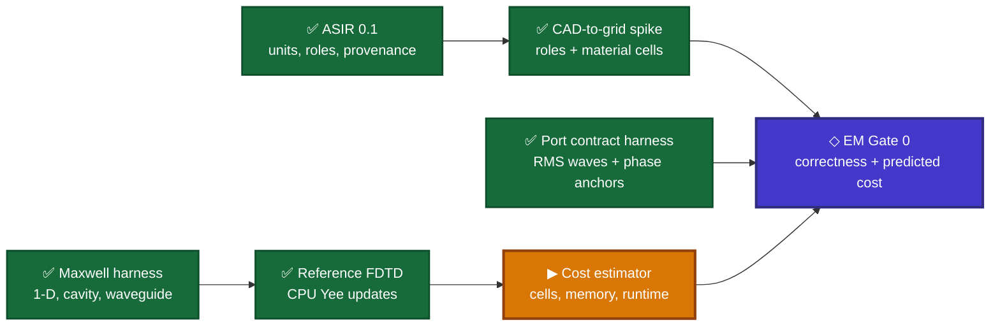
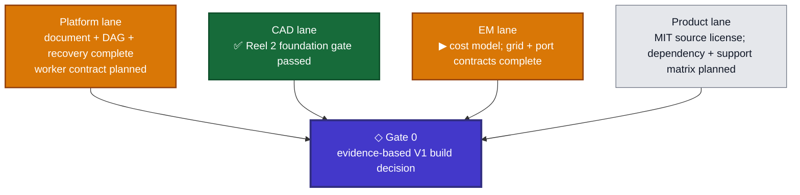

# Development Storyboard

**Status date:** October 10, 2026

**Current frame:** The reference solver, RMS multiport contract, and traceable CAD-to-grid spike pass their acceptance suites. The next implementation target is the measured cell, memory, step-count, runtime, and checkpoint cost model.

This storyboard translates the [architecture and development plan](implemention_plans/Fusio360_Vive_CAD_Architecture_and_Development_Plan.md) into visible product scenes. A completed panel means its stated evidence exists and passes; the panels are not equal in effort, so their count is not a project-completion percentage.

## Status legend

| Mark | Meaning |
|---|---|
| ✅ | Implemented and verified |
| ▶ | Current development target |
| ◇ | Planned decision gate |
| ○ | Planned implementation |

## Reel 1 — Establish a trustworthy foundation

| Scene | What becomes visible | Acceptance evidence | Status |
|---|---|---|---|
| Product boundary | A desktop-first mechanical CAD and broadband antenna FDTD V1 with explicit deferrals | Architecture plan and resolved state, optimization, and multiport contracts | ✅ |
| Buildable workspace | CAD Studio, EM Studio, model engine, and simulation worker compile from one preset | CMake/Ninja debug build and four process smoke tests | ✅ |
| Honest document state | A valid edit may fail regeneration without lying about which geometry is current | Separate semantic/evaluated revisions, typed `CurrentGeometryUnavailable`, repair and undo/redo tests | ✅ |
| Atomic edits | Several parameter edits commit as one revision or none of them apply | Typed transaction validation, immutable revisions, append-only command journal, replay validation | ✅ |
| Restart recovery | A failed or repaired document can be written, replaced atomically, and reopened | Versioned internal checkpoint, checksum and bounds checks, durable sibling-file replacement | ✅ |
| Feature evaluation | Editing one feature dirties and evaluates only its dependents in deterministic order | DAG cycle rejection, dirty propagation, blocked descendants, independent-branch preservation | ✅ |

Current implementation evidence:

- [Document state and transaction API](../modules/platform/document/include/oep/document/document.hpp)
- [Document state-machine implementation](../modules/platform/document/src/document.cpp)
- [Recovery-checkpoint API](../modules/platform/persistence/include/oep/persistence/checkpoint.hpp)
- [Document behavior tests](../tests/unit/document_state_machine_test.cpp)
- [Persistence and corruption tests](../tests/unit/persistence_checkpoint_test.cpp)
- [Feature DAG scheduler and transaction implementation](../modules/platform/document/src/document.cpp)
- [Feature dependency, failure, recovery, and cycle tests](../tests/unit/feature_dependency_graph_test.cpp)

## Reel 2 — Reach the first end-to-end CAD scene

The first CAD reel ends with this user-visible story:

> Create a constrained sketch → extrude → add a fillet → attach a sketch to the fillet result → cut a hole → change the first dimension → preserve or diagnose every reference → intentionally create a failed regeneration → save and reopen that state → repair or undo it → reproduce the valid model.

| CAD foundation panel | Engineering content | Done when |
|---|---|---|
| ✅ Feature DAG | Stable feature IDs, typed dependencies, deterministic topological ordering, minimal dirty subgraph | Verified by the [feature dependency graph test](../tests/unit/feature_dependency_graph_test.cpp): independent branches remain clean, cycles are rejected before commit, failures block descendants, and failed state survives save/reopen plus undo/redo |
| ✅ Golden corpus | Representative valid, degenerate, topology-changing, attached-sketch, recovery, cancellation, and parameter-sweep fixtures | The [shared nine-case corpus](../tests/golden/cad/kernel_corpus.cpp) produces comparable reports from both adapters; its coverage is recorded in the [corpus guide](../tests/golden/cad/README.md) |
| ✅ Kernel adapter | Exact-body handles, operation requests/results, provenance, diagnostics, snapshots, and cancellation boundary | The [kernel-neutral contract](../modules/cad/modeler/include/oep/modeler/kernel_adapter.hpp) and [deterministic fake](../tests/golden/cad/fake_geometry_kernel.cpp) pass the [contract suite](../tests/golden/cad/kernel_adapter_contract_test.cpp) |
| ✅ OCCT spike | Extrude, cut, fillet, pattern, attached sketch support, healing, and exact-body snapshots | The [OCCT exact B-rep adapter](../modules/cad/modeler/src/occt_geometry_kernel.cpp) passes the [same corpus](../tests/golden/cad/occt_kernel_adapter_contract_test.cpp), including typed failures and deterministic snapshot restoration |
| ✅ Topology identity | Generated/modified/deleted provenance, signatures, confidence, and ambiguity | The [persistent identity service](../modules/cad/topology_id/include/oep/topology_id/topology_identity.hpp) and [adversarial unit suite](../tests/unit/topology_identity_test.cpp) reject silent reassignment; the [shared mutation corpus](../tests/golden/cad/topology_mutation_corpus.cpp) passes against fake and OCCT adapters |
| ✅ Constrained sketch | Stable entity IDs, geometric constraints, dimensions, and solver diagnostics | The [sketch contract and deterministic solver](../modules/cad/sketch/include/oep/sketch/sketch.hpp) pass the [classification and identity suite](../tests/unit/sketch_solver_test.cpp): parameter changes preserve IDs and under-, fully-, over-, and inconsistently constrained cases remain distinct |
| ✅ Modeling thread | Sketch and feature commands connected through the document evaluator and checkpoint path | The [CAD feature evaluator](../modules/cad/modeler/include/oep/modeler/cad_feature_evaluator.hpp) composes sketch → extrude → fillet → attached sketch → cut, with every upstream topology decision retained as a typed evaluation diagnostic |
| ✅ CAD foundation gate | Parameter change, reference recovery, failed regeneration, restart, repair, undo/redo, and deterministic reopen | The [shared headless acceptance corpus](../tests/golden/cad/modeling_thread_corpus.cpp) passes against the deterministic fake and the OCCT exact B-rep adapter; explicit restart hydration follows [ADR 0001](architecture/decisions/0001-explicit-cad-evaluator-hydration.md) |

## Reel 3 — Develop the EM path in parallel

The first EM reel ends with this user-visible story:

> Tag CAD entities with EM roles → generate validated ASIR → inspect grid and resource estimates → run a reference FDTD case → store normalized immutable results → change a CAD-authoritative parameter in an isolated candidate → promote it through a guarded transaction → rerun and compare both result sets.

| EM foundation panel | Engineering content | Done when |
|---|---|---|
| ✅ ASIR 0.1 | Evaluated-CAD authority, dimensioned SI values, exact-body references, persistent EM roles, materials, ports, boundaries, solver/mesh policy, budgets, monitors, goals, provenance, and content identity | The [compiled ASIR contract](../modules/em/simulation_ir/include/oep/simulation_ir/simulation_ir.hpp), [versioned schema](../schemas/simulation_ir/asir-0.1.md), and [validation suite](../tests/unit/simulation_ir_test.cpp) accept a complete antenna study and reject stale/failed CAD state, missing topology, duplicate ports, unspecified dimensions, invalid material bands, and authority violations; fingerprints are canonical SHA-256 values |
| ✅ Maxwell harness | Independent analytic fixtures and error metrics for one-dimensional propagation, rectangular cavity, and waveguide modes | The [compiled oracle](../tests/golden/em/include/oep/test/maxwell_harness.hpp) and [canonical cases](../tests/golden/em/maxwell_harness.cpp) freeze analytic values, typed invalid-mode and cutoff failures, convergence criteria, conservation checks, and restart expectations; the [contract suite](../tests/golden/em/maxwell_harness_test.cpp) verifies the formulas and assessment behavior documented in the [harness guide](../tests/golden/em/README.md) |
| ✅ Reference FDTD | Double-precision CPU Yee updates, stable time step, sources, probes, PEC/open boundaries, and restart | The [compiled reference API](../modules/em/fdtd_engine/include/oep/fdtd/reference_fdtd.hpp) and [Yee implementation](../modules/em/fdtd_engine/src/reference_fdtd.cpp) provide typed configuration, 1-D periodic/PEC/Mur boundaries, 3-D PEC updates, source/probe access, discrete energy and dispersion, and checksummed restart; the [unit contract](../tests/unit/reference_fdtd_test.cpp) and [golden acceptance suite](../tests/golden/em/reference_fdtd_maxwell_test.cpp) pass every frozen tolerance documented in the [module guide](../modules/em/fdtd_engine/README.md) and [ADR 0004](architecture/decisions/0004-fp64-yee-reference-solver.md) |
| ✅ Port contract harness | Versioned RMS power-wave, orientation, phase-anchor, reference-plane, and reconstruction conventions | The independent [compiled port oracle](../tests/golden/em/include/oep/test/port_contract_harness.hpp), [analytic four-port fixture](../tests/golden/em/port_contract_harness.cpp), and [golden contract suite](../tests/golden/em/port_contract_harness_test.cpp) prove RMS power identity, deterministic modal anchoring, matched inactive ports, complex-drive S/field reconstruction, explicit metric denominators, passivity, reciprocity, and reversible plane shifts under [ADR 0005](architecture/decisions/0005-versioned-rms-port-contract.md) |
| ✅ CAD-to-grid spike | Persistent roles and material regions converted into traceable Cartesian cells | The compiled [geometry preparation contract](../modules/em/em_geometry/include/oep/em_geometry/computational_geometry.hpp) and [Cartesian grid contract](../modules/em/em_mesh/include/oep/em_mesh/cartesian_grid.hpp) retain ASIR/geometry hashes, material catalogs, role IDs, port metadata, and persistent CAD IDs through exact box/patch subcell mappings; the [acceptance suite](../tests/unit/cad_to_grid_test.cpp) proves deterministic ordering, volume conservation, unresolved/stale identity rejection, hard cell budgets, material conflict rejection, and explicit staircasing risk under [ADR 0006](architecture/decisions/0006-traceable-axis-aligned-cad-grid-spike.md) |
| ▶ Cost estimator | Cell, memory, time-step, runtime, and storage prediction with hard budgets | Predicted scaling and tiny-feature impact are checked against measured reference runs |

## Gate 0 convergence

Gate 0 is reached only when all four lanes provide evidence. A polished shell or isolated geometry demo does not satisfy the gate.

## Current development frame

The reference FDTD engine and port harness now provide the first native numerical Maxwell path and its normalized multiport boundary:

1. One-dimensional and three-dimensional FP64 grids store electric and magnetic components at conventional staggered Yee locations and advance them with explicit leapfrog curl updates.
2. The time step is derived from grid spacing, lossless material constants, dimensionality, and a validated Courant factor. Invalid grid sizes, material values, boundary combinations, sources, and checkpoints produce typed diagnostics; unsupported modal-dispersion requests return no result.
3. The 1-D path supports paired periodic, PEC, and first-order Mur boundaries. The 3-D path currently supports PEC faces; three-dimensional CPML remains later work.
4. Explicit hard/soft electric sources and staggered probes are validated before mutation. Read-only field spans expose complete verification state.
5. Versioned binary checkpoints cover grid/material policy, step index, discrete energy, and every field value. Bounds, dimensionality, field extents, finite values, version, trailing bytes, and checksum are verified before restore.
6. Plane-wave propagation records phase error `5.46e-4`, field L2 `3.47e-3`, Mur reflection `1.27e-5`, convergence order `2.024`, roundoff-scale energy residual, and bit-exact restart.
7. The TM111 cavity records frequency error `2.69e-3`, field L2 `3.28e-5`, order `2.047`, roundoff-scale energy residual, and bit-exact restart. Its time-stepped zero crossings agree with the stencil prediction.
8. The WR90 TE10 case records cutoff error `2.47e-3`, propagation error `1.60e-3`, order `2.002`, roundoff-scale field/energy errors, and bit-exact restart.
9. Port contract `oep-rms-power-wave-1.0` fixes RMS `exp(+jωt)` phasors, inward current, positive-real impedance, `sqrt(W)` incident/outgoing waves, and radiated/accepted/incident metric denominators.
10. The four-port fixture reconstructs two stored complex simultaneous drives from matched one-port basis runs within `1e-12`; its maximum power gain is `0.1726874826`, reciprocity error is zero, and lossless reference-plane shifts preserve both properties.
11. Weak modal overlaps, ambiguous degenerate bases, invalid orientations, cutoff modes, unmatched inactive ports, non-positive impedance, and inconsistent vector dimensions fail with typed diagnostics.
12. The CAD-to-grid spike rejects stale or unresolved topology before mapping. Stable ASIR role order, exact geometry hashes, material catalogs, and persistent CAD feature/local IDs survive into material, surface, port-face, and reference-plane cell records.
13. Analytic box/patch intersections preserve subcell volume and area. The fixture maps a `4 × 3 × 2` domain, conserves the offset substrate volume, and reports its `1.5`-cell minimum dimension as high staircasing risk instead of silently accepting the binary approximation.
14. Grid limits, out-of-domain geometry, overlapping material volumes, invalid dominant-material policy, and unmappable surfaces fail with typed diagnostics. Axis-aligned primitives and diagnostic subcells are the present boundary; general B-rep intersection and heterogeneous FDTD updates remain unfinished.

The active panel is the cost estimator: use the now-runnable reference grids to predict cells, FP64 field and checkpoint memory, Courant-limited steps, runtime, and storage, then calibrate those predictions against measured runs and explicit resource budgets.

## Progress snapshot

| Area | Present state |
|---|---|
| Build | C++20 CMake/Ninja monorepo; four process targets; optional locally bootstrapped OCCT build |
| Project license | Project-owned code and documentation use MIT with SPDX headers on source, build, and script files; dependency licensing and contribution policy remain open product-lane work |
| Compiled libraries | `oep::document`, `oep::persistence`, `oep::sketch`, `oep::modeler`, `oep::topology_id`, `oep::cad_feature_model`, `oep::simulation_ir`, `oep::em_geometry`, `oep::em_mesh`, `oep::fdtd_engine`, and optional `oep::occt_geometry_kernel` |
| Automated checks | Default preset: eighteen CTest entries; OCCT preset: twenty-one entries including ASIR validation, CAD-to-grid mapping, Maxwell and port oracles, FDTD acceptance, exact-kernel, topology-mutation, and full modeling-thread coverage |
| Strictness | Warnings treated as errors; default and OCCT builds pass; all 18 default and 21 OCCT-enabled checks pass ASan/UBSan with leak checking disabled under the traced test environment |
| Data safety | Typed stale-geometry denial, DAG and journal replay validation, bounded checkpoint decoding, checksum verification, atomic replacement |
| Feature evaluation | Stable feature IDs and typed inputs; deterministic topological scheduling; minimal dirty propagation; blocked descendants; atomic cycle rejection |
| Geometry capability | Deterministic constrained sketches; kernel-neutral exact-body features; persistent topology decisions; restart-safe sketch → extrude → fillet → attached sketch → cut evaluation |
| Desktop capability | Process entry points exist; Qt UI and viewport are not implemented yet |
| EM capability | Validated ASIR 0.1, independent Maxwell and RMS multiport harnesses, the FP64 reference CPU Yee solver, and traceable axis-aligned CAD-to-grid mapping are complete; resource-cost calibration is next, while general B-rep intersection, 3-D CPML, calibrated solver ports, heterogeneous updates, production kernels, and normalized result storage remain planned |

## Updating this storyboard

When a panel completes:

1. Change its mark only after the acceptance evidence passes.
2. Link the implementation and the test that demonstrates the behavior.
3. Move the current marker to the next dependency-ready panel.
4. Update the progress snapshot without interpreting panel count as percent complete.
5. Record architecture-changing decisions in `docs/architecture/decisions/`.
