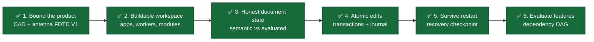
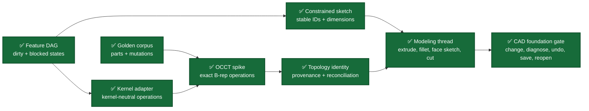
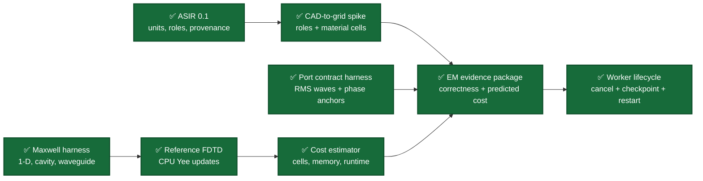
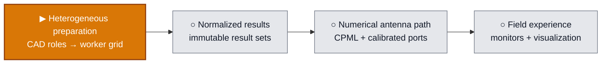
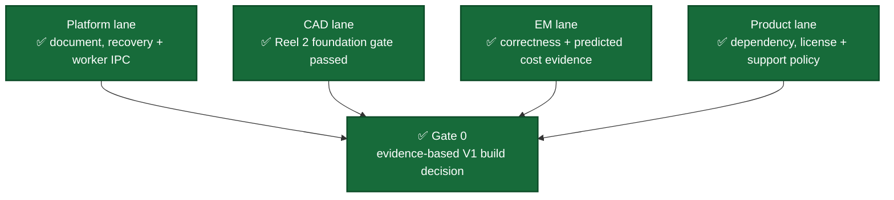

# Development Storyboard

**Status date:** October 12, 2026

**Current frame:** Reel 4 is complete. Worker recovery now travels atomically with CAD and ASIR in project-checkpoint v2, validates nested integrity and authority before activation, and resumes exact progress in a fresh desktop session. The next dependency-ready target is heterogeneous CAD-to-worker preparation so the visible worker executes the authored material/role model instead of a homogeneous preview.

This storyboard translates the [architecture and development plan](implemention_plans/Fusio360_Vive_CAD_Architecture_and_Development_Plan.md) into visible product scenes. A completed panel means its stated evidence exists and passes; the panels are not equal in effort, so their count is not a project-completion percentage.

## Status legend

| Mark | Meaning |
|---|---|
| ✅ | Implemented and verified |
| ▶ | Current development target |
| ◇ | Planned decision gate |
| ○ | Planned implementation |

## Reel 1 — Establish a trustworthy foundation

| Scene | What becomes visible | Acceptance evidence | Status |
|---|---|---|---|
| Product boundary | A desktop-first mechanical CAD and broadband antenna FDTD V1 with explicit deferrals | Architecture plan and resolved state, optimization, and multiport contracts | ✅ |
| Buildable workspace | CAD Studio, EM Studio, model engine, and simulation worker compile from one preset | CMake/Ninja debug build and four process smoke tests | ✅ |
| Honest document state | A valid edit may fail regeneration without lying about which geometry is current | Separate semantic/evaluated revisions, typed `CurrentGeometryUnavailable`, repair and undo/redo tests | ✅ |
| Atomic edits | Several parameter edits commit as one revision or none of them apply | Typed transaction validation, immutable revisions, append-only command journal, replay validation | ✅ |
| Restart recovery | A failed or repaired document can be written, replaced atomically, and reopened | Versioned internal checkpoint, checksum and bounds checks, durable sibling-file replacement | ✅ |
| Feature evaluation | Editing one feature dirties and evaluates only its dependents in deterministic order | DAG cycle rejection, dirty propagation, blocked descendants, independent-branch preservation | ✅ |

Current implementation evidence:

- [Document state and transaction API](../modules/platform/document/include/oep/document/document.hpp)
- [Document state-machine implementation](../modules/platform/document/src/document.cpp)
- [Recovery-checkpoint API](../modules/platform/persistence/include/oep/persistence/checkpoint.hpp)
- [Document behavior tests](../tests/unit/document_state_machine_test.cpp)
- [Persistence and corruption tests](../tests/unit/persistence_checkpoint_test.cpp)
- [Feature DAG scheduler and transaction implementation](../modules/platform/document/src/document.cpp)
- [Feature dependency, failure, recovery, and cycle tests](../tests/unit/feature_dependency_graph_test.cpp)

## Reel 2 — Reach the first end-to-end CAD scene

The first CAD reel ends with this user-visible story:

> Create a constrained sketch → extrude → add a fillet → attach a sketch to the fillet result → cut a hole → change the first dimension → preserve or diagnose every reference → intentionally create a failed regeneration → save and reopen that state → repair or undo it → reproduce the valid model.

| CAD foundation panel | Engineering content | Done when |
|---|---|---|
| ✅ Feature DAG | Stable feature IDs, typed dependencies, deterministic topological ordering, minimal dirty subgraph | Verified by the [feature dependency graph test](../tests/unit/feature_dependency_graph_test.cpp): independent branches remain clean, cycles are rejected before commit, failures block descendants, and failed state survives save/reopen plus undo/redo |
| ✅ Golden corpus | Representative valid, degenerate, topology-changing, attached-sketch, recovery, cancellation, and parameter-sweep fixtures | The [shared nine-case corpus](../tests/golden/cad/kernel_corpus.cpp) produces comparable reports from both adapters; its coverage is recorded in the [corpus guide](../tests/golden/cad/README.md) |
| ✅ Kernel adapter | Exact-body handles, operation requests/results, provenance, diagnostics, snapshots, and cancellation boundary | The [kernel-neutral contract](../modules/cad/modeler/include/oep/modeler/kernel_adapter.hpp) and [deterministic fake](../tests/golden/cad/fake_geometry_kernel.cpp) pass the [contract suite](../tests/golden/cad/kernel_adapter_contract_test.cpp) |
| ✅ OCCT spike | Extrude, cut, fillet, pattern, attached sketch support, healing, and exact-body snapshots | The [OCCT exact B-rep adapter](../modules/cad/modeler/src/occt_geometry_kernel.cpp) passes the [same corpus](../tests/golden/cad/occt_kernel_adapter_contract_test.cpp), including typed failures and deterministic snapshot restoration |
| ✅ Topology identity | Generated/modified/deleted provenance, signatures, confidence, and ambiguity | The [persistent identity service](../modules/cad/topology_id/include/oep/topology_id/topology_identity.hpp) and [adversarial unit suite](../tests/unit/topology_identity_test.cpp) reject silent reassignment; the [shared mutation corpus](../tests/golden/cad/topology_mutation_corpus.cpp) passes against fake and OCCT adapters |
| ✅ Constrained sketch | Stable entity IDs, geometric constraints, dimensions, and solver diagnostics | The [sketch contract and deterministic solver](../modules/cad/sketch/include/oep/sketch/sketch.hpp) pass the [classification and identity suite](../tests/unit/sketch_solver_test.cpp): parameter changes preserve IDs and under-, fully-, over-, and inconsistently constrained cases remain distinct |
| ✅ Modeling thread | Sketch and feature commands connected through the document evaluator and checkpoint path | The [CAD feature evaluator](../modules/cad/modeler/include/oep/modeler/cad_feature_evaluator.hpp) composes sketch → extrude → fillet → attached sketch → cut, with every upstream topology decision retained as a typed evaluation diagnostic |
| ✅ CAD foundation gate | Parameter change, reference recovery, failed regeneration, restart, repair, undo/redo, and deterministic reopen | The [shared headless acceptance corpus](../tests/golden/cad/modeling_thread_corpus.cpp) passes against the deterministic fake and the OCCT exact B-rep adapter; explicit restart hydration follows [ADR 0001](architecture/decisions/0001-explicit-cad-evaluator-hydration.md) |

## Reel 3 — Develop the EM path in parallel

The first EM reel ends with this user-visible story:

> Tag CAD entities with EM roles → generate validated ASIR → inspect grid and resource estimates → run a reference FDTD case → store normalized immutable results → change a CAD-authoritative parameter in an isolated candidate → promote it through a guarded transaction → rerun and compare both result sets.

| EM foundation panel | Engineering content | Done when |
|---|---|---|
| ✅ ASIR 0.1 | Evaluated-CAD authority, dimensioned SI values, exact-body references, persistent EM roles, materials, ports, boundaries, solver/mesh policy, budgets, monitors, goals, provenance, and content identity | The [compiled ASIR contract](../modules/em/simulation_ir/include/oep/simulation_ir/simulation_ir.hpp), [versioned schema](../schemas/simulation_ir/asir-0.1.md), and [validation suite](../tests/unit/simulation_ir_test.cpp) accept a complete antenna study and reject stale/failed CAD state, missing topology, duplicate ports, unspecified dimensions, invalid material bands, and authority violations; fingerprints are canonical SHA-256 values |
| ✅ Maxwell harness | Independent analytic fixtures and error metrics for one-dimensional propagation, rectangular cavity, and waveguide modes | The [compiled oracle](../tests/golden/em/include/oep/test/maxwell_harness.hpp) and [canonical cases](../tests/golden/em/maxwell_harness.cpp) freeze analytic values, typed invalid-mode and cutoff failures, convergence criteria, conservation checks, and restart expectations; the [contract suite](../tests/golden/em/maxwell_harness_test.cpp) verifies the formulas and assessment behavior documented in the [harness guide](../tests/golden/em/README.md) |
| ✅ Reference FDTD | Double-precision CPU Yee updates, stable time step, sources, probes, PEC/open boundaries, and restart | The [compiled reference API](../modules/em/fdtd_engine/include/oep/fdtd/reference_fdtd.hpp) and [Yee implementation](../modules/em/fdtd_engine/src/reference_fdtd.cpp) provide typed configuration, 1-D periodic/PEC/Mur boundaries, 3-D PEC updates, source/probe access, discrete energy and dispersion, and checksummed restart; the [unit contract](../tests/unit/reference_fdtd_test.cpp) and [golden acceptance suite](../tests/golden/em/reference_fdtd_maxwell_test.cpp) pass every frozen tolerance documented in the [module guide](../modules/em/fdtd_engine/README.md) and [ADR 0004](architecture/decisions/0004-fp64-yee-reference-solver.md) |
| ✅ Port contract harness | Versioned RMS power-wave, orientation, phase-anchor, reference-plane, and reconstruction conventions | The independent [compiled port oracle](../tests/golden/em/include/oep/test/port_contract_harness.hpp), [analytic four-port fixture](../tests/golden/em/port_contract_harness.cpp), and [golden contract suite](../tests/golden/em/port_contract_harness_test.cpp) prove RMS power identity, deterministic modal anchoring, matched inactive ports, complex-drive S/field reconstruction, explicit metric denominators, passivity, reciprocity, and reversible plane shifts under [ADR 0005](architecture/decisions/0005-versioned-rms-port-contract.md) |
| ✅ CAD-to-grid spike | Persistent roles and material regions converted into traceable Cartesian cells | The compiled [geometry preparation contract](../modules/em/em_geometry/include/oep/em_geometry/computational_geometry.hpp) and [Cartesian grid contract](../modules/em/em_mesh/include/oep/em_mesh/cartesian_grid.hpp) retain ASIR/geometry hashes, material catalogs, role IDs, port metadata, and persistent CAD IDs through exact box/patch subcell mappings; the [acceptance suite](../tests/unit/cad_to_grid_test.cpp) proves deterministic ordering, volume conservation, unresolved/stale identity rejection, hard cell budgets, material conflict rejection, and explicit staircasing risk under [ADR 0006](architecture/decisions/0006-traceable-axis-aligned-cad-grid-spike.md) |
| ✅ Cost estimator | Cell, memory, time-step, runtime, and storage prediction with hard budgets | The [compiled estimator](../modules/em/simulation_cost/include/oep/simulation_cost/simulation_cost.hpp) counts exact staggered FP64 fields, update scratch, checkpoint bytes, Courant steps, retained storage, and named-hardware runtime intervals; the [unit suite](../tests/unit/simulation_cost_test.cpp) proves all four budget paths and roughly sixteen-fold tiny-feature work, while the [measured calibration acceptance](../tests/golden/em/simulation_cost_calibration_test.cpp) checks a live holdout run under [ADR 0007](architecture/decisions/0007-measured-reference-fdtd-cost-model.md) |
| ✅ Worker lifecycle | Prepared-job validation, resource approval, authoritative progress, cancellation, checkpoint restart, and raw artifact collection across a process boundary | The [solver-neutral lifecycle contract](../modules/em/em_solver_api/include/oep/em_solver_api/solver_api.hpp), [reference worker](../modules/em/simulation_orchestrator/include/oep/simulation_orchestrator/reference_worker.hpp), and [typed protocol](../modules/em/simulation_orchestrator/include/oep/simulation_orchestrator/worker_protocol.hpp) run over [bounded versioned IPC](../modules/platform/ipc/include/oep/ipc/frame.hpp); the [unit lifecycle suite](../tests/unit/simulation_worker_lifecycle_test.cpp) and [real-process restart acceptance](../tests/integration/simulation_worker_process_test.cpp) prove resource gating, correlated status, cancellation, exact resume in a fresh worker, and provenance-preserving collection under [ADR 0008](architecture/decisions/0008-versioned-simulation-worker-lifecycle.md) |

## Reel 4 — Make the engineering workflow visible

The UI reel begins with an interaction prototype that can be reviewed before native toolkit and rendering work harden the layout. It carries one project between CAD Studio and EM Studio so geometry authority, study preparation, and simulation readiness remain one continuous product story.

| UI panel | Product behavior | Done when |
|---|---|---|
| ✅ Interactive wireframe | Shared application chrome, CAD feature browser and history, EM study tree and preflight, contextual inspector, engineering overlays, command palette, and simulated solve progress | The [dependency-free prototype](../apps/ui_wireframe/index.html) loads without external assets, both studios and their selectable entities are represented, interactive JavaScript passes syntax validation, and the files are exposed through the `oep_ui_wireframe` CMake target |
| ✅ Native application shell | Accessible Qt 6/QML window, shared visual tokens, docking, keyboard navigation, and persisted panel layout | The shared [application host](../modules/platform/app_shell/src/application_qt.cpp), [QML shell](../modules/platform/app_shell/qml/Main.qml), and [layout controller](../modules/platform/app_shell/src/shell_controller.cpp) launch from both products; strict Qt builds, QML lint, offscreen navigation/accessibility launch contracts, and [persistence tests](../tests/unit/app_shell_state_test.cpp) pass |
| ✅ Engine-bound panels | UI state projects typed document, feature, ASIR, and diagnostic state without owning business rules | [Typed feature projections and controller acceptance](../tests/unit/app_shell_state_test.cpp) cover all six scheduler states, failed/stale CAD, recovery/Undo, rejected commands, and fresh-session CAD+ASIR loading; [ASIR recovery tests](../tests/unit/simulation_ir_test.cpp) verify complete bounded content; [offscreen UI actions](../modules/platform/app_shell/src/application_qt.cpp) exercise authoring and project Save/Open. Transient dirty/evaluating states are presenter-tested; the synchronous host publishes final records. |
| ✅ Native viewport | Immutable scene packets, camera navigation, selection/preselection, clipping, and persistent IDs | Exact-body lifecycle passes [controller acceptance](../tests/unit/app_shell_state_test.cpp). The [viewport corpus](../tests/unit/viewport_projection_test.cpp) verifies shared immutable LODs, transforms, materials, visibility, occurrence-qualified picking, and 1,048,576 source triangles at an approximately 0.82 ms observed 120-frame average against a 16.667 ms strict-debug gate. GPU/ten-million-triangle work remains a later scalability target. |
| ✅ Worker experience | Solver preflight, resource estimate, launch, progress, cancellation, checkpoint, and result provenance | The visible Qt controls run the real reference lifecycle through raw artifact collection. Project-checkpoint v2 atomically retains a verified job/checkpoint with CAD and ASIR; [fresh-session controller acceptance](../tests/unit/app_shell_state_test.cpp) restores exact progress, rejects nested corruption and ASIR mismatch before activation, completes, and collects. |

## Reel 5 — Execute the authored electromagnetic model

The first Reel 5 slice replaces the Worker tab's bounded homogeneous preview with a validated adapter from the existing traceable CAD-to-grid output. It must preserve ASIR, geometry, material, role, port, solver-build, and resource-estimate authority through preparation and reject unsupported authored policies explicitly.

## Gate 0 convergence

Gate 0 is complete because all four lanes now provide reviewable evidence. This approves the V1 implementation direction; it is not a public-release claim, dependency distribution approval, or statement that later reels are complete.

## Current development frame

The reference FDTD engine and port harness provide the first native numerical Maxwell path and its normalized multiport boundary:

1. One-dimensional and three-dimensional FP64 grids store electric and magnetic components at conventional staggered Yee locations and advance them with explicit leapfrog curl updates.
2. The time step is derived from grid spacing, lossless material constants, dimensionality, and a validated Courant factor. Invalid grid sizes, material values, boundary combinations, sources, and checkpoints produce typed diagnostics; unsupported modal-dispersion requests return no result.
3. The 1-D path supports paired periodic, PEC, and first-order Mur boundaries. The 3-D path currently supports PEC faces; three-dimensional CPML remains later work.
4. Explicit hard/soft electric sources and staggered probes are validated before mutation. Read-only field spans expose complete verification state.
5. Versioned binary checkpoints cover grid/material policy, step index, discrete energy, and every field value. Bounds, dimensionality, field extents, finite values, version, trailing bytes, and checksum are verified before restore.
6. Plane-wave propagation records phase error `5.46e-4`, field L2 `3.47e-3`, Mur reflection `1.27e-5`, convergence order `2.024`, roundoff-scale energy residual, and bit-exact restart.
7. The TM111 cavity records frequency error `2.69e-3`, field L2 `3.28e-5`, order `2.047`, roundoff-scale energy residual, and bit-exact restart. Its time-stepped zero crossings agree with the stencil prediction.
8. The WR90 TE10 case records cutoff error `2.47e-3`, propagation error `1.60e-3`, order `2.002`, roundoff-scale field/energy errors, and bit-exact restart.
9. Port contract `oep-rms-power-wave-1.0` fixes RMS `exp(+jωt)` phasors, inward current, positive-real impedance, `sqrt(W)` incident/outgoing waves, and radiated/accepted/incident metric denominators.
10. The four-port fixture reconstructs two stored complex simultaneous drives from matched one-port basis runs within `1e-12`; its maximum power gain is `0.1726874826`, reciprocity error is zero, and lossless reference-plane shifts preserve both properties.
11. Weak modal overlaps, ambiguous degenerate bases, invalid orientations, cutoff modes, unmatched inactive ports, non-positive impedance, and inconsistent vector dimensions fail with typed diagnostics.
12. The CAD-to-grid spike rejects stale or unresolved topology before mapping. Stable ASIR role order, exact geometry hashes, material catalogs, and persistent CAD feature/local IDs survive into material, surface, port-face, and reference-plane cell records.
13. Analytic box/patch intersections preserve subcell volume and area. The fixture maps a `4 × 3 × 2` domain, conserves the offset substrate volume, and reports its `1.5`-cell minimum dimension as high staircasing risk instead of silently accepting the binary approximation.
14. Grid limits, out-of-domain geometry, overlapping material volumes, invalid dominant-material policy, and unmappable surfaces fail with typed diagnostics. Axis-aligned primitives and diagnostic subcells are the present boundary; general B-rep intersection and heterogeneous FDTD updates remain unfinished.
15. The cost estimator counts every staggered electric and magnetic value, FP64 field byte, electric-field scratch copy, serialized checkpoint byte, Courant-limited step, logical cell update, and retained result byte before solver allocation.
16. Runtime calibration consumes named hardware/build observations and retains measured cell updates per second plus a prediction interval. The live holdout acceptance matches solver field and checkpoint bytes exactly and bounds predicted-versus-actual wall time.
17. Cell, memory, conservative upper-bound runtime, and storage budgets are assessed independently. Exceeded estimates remain reviewable and obey the ASIR escalation policy instead of silently reducing fidelity.
18. Halving uniform cell spacing over the same three-dimensional domain produces eight times the cells, about twice the steps, and more than fifteen times the logical update work, making small-feature cost pressure explicit.
19. The solver-neutral worker contract carries the prepared grid, ASIR fingerprint, immutable cost snapshot, budget disposition, worker/build identity, exact step progress, typed diagnostics, checkpoints, and raw artifacts without exposing solver state to the UI.
20. The local frame format versions and checksums every correlated message and enforces payload, frame-count, text, diagnostic, blob, and whole-batch bounds before dispatch.
21. The reference worker rejects invalid estimates, solver-build mismatches, and unapproved over-budget jobs before allocation. Cancellation is idempotent and terminal, and only successful jobs expose raw artifacts.
22. A process acceptance test checkpoints at step four, exits the worker, resumes the exact field state in a fresh process, reaches step eight, and collects an artifact retaining job, study, solver-build, progress, and final-checkpoint provenance.

The interactive UI wireframe now makes this foundation visible without introducing a second business-logic path. It presents representative state for:

1. a CAD feature browser, selected topology, contextual properties, evaluation status, diagnostics, and linear view of the feature DAG;
2. a continuous transition from authoritative CAD geometry into an EM study;
3. materials, persistent roles, RMS-normalized port setup, boundaries, monitors, the Cartesian grid, ASIR authority, and preflight status;
4. viewport grid and engineering-overlay controls, keyboard command discovery, and a synthetic reference-solve progress flow.

The wireframe remains a dependency-free interaction reference. It does not mutate documents or run the solver. Those actions stay with the compiled command, transaction, and worker boundaries.

The native application shell now turns that interaction vocabulary into one compiled desktop surface:

1. CAD Studio and EM Studio call the same `oep::app_shell` host and select their initial workspace explicitly.
2. The exact Qt 6.4.2 build enables only Core, Gui, Qml, Quick, and Quick Controls 2. The Ubuntu bootstrap extracts a checksum-locked local SDK without changing the host installation.
3. Shared QML tokens drive the shell chrome, focus treatment, status colors, and panel styling.
4. Horizontal and vertical split views provide resizable project, viewport, inspector, and diagnostic regions. Widths, heights, and visibility survive restart through versioned settings keys, while each executable remains authoritative for its initial workspace.
5. Menus, focusable controls, accessible names and descriptions, `Ctrl+1`/`Ctrl+2` workspace switching, `Ctrl+K` command discovery, `Ctrl+J` diagnostics, Tab navigation, and Escape behavior establish the keyboard and accessibility baseline.
6. The CAD browser, revision status, diagnostics, and undo/redo use the host-attached document adapter. The EM browser, setup inspector, and scrollable preflight project a real ASIR draft and validator report. In `qt-cad`, the center renders current exact geometry and returns occurrence-qualified persistent face IDs.
7. The EM Worker tab binds execution provenance, displays a calibrated bounded estimate, and runs the reference lifecycle with progress, cancellation, checkpoint, fresh-worker resume, and raw artifact collection.
8. The Qt-only preset passes twenty-six checks and the Qt + OCCT preset passes twenty-nine, including QML lint, persisted shell state, deterministic viewport behavior, exact-body scene lifecycle, and visible Worker control acceptance. Both desktop entry points load the complete shell offscreen and assert its navigation/accessibility contract.

The [dependency and license matrix](product/DEPENDENCY_LICENSE_MATRIX.md) now records the current OCCT/oneTBB path, the optional checksum-locked Qt 6.4.2 development path, and gates Kokkos, Open MPI, CUDA, VTK, and HDF5 behind pinned versions, transitive-license review, adapter tests, notices, and artifact-level SBOM evidence. MFEM/PETSc/hypre stay with the later FEM program, and Gmsh remains outside the linked or bundled open V1 baseline under its GPL terms.

The [compute support policy](product/COMPUTE_SUPPORT_POLICY.md) keeps the implemented FP64 single-threaded solver as the correctness authority, selects Kokkos OpenMP and NVIDIA CUDA as the first production CPU/GPU profiles, and makes Linux Open MPI the first distributed profile. HIP, SYCL, Apple GPU, mixed precision, and unqualified multi-GPU execution remain explicit deferrals. Current WSL2 results are functional evidence only; native workstation and cluster hardware must be named before performance claims.

The engine-bound UI now exposes these reviewable workflows:

| Visible workflow | Acceptance evidence |
|---|---|
| Create the five-feature OCCT example, select a feature, edit parameters, diagnose regeneration, and undo/redo | [Shell controller](../modules/platform/app_shell/src/shell_controller.cpp), [controller acceptance](../tests/unit/app_shell_state_test.cpp), and [offscreen UI actions](../modules/platform/app_shell/src/application_qt.cpp) |
| Save/reopen valid or failed CAD, recover through Undo, and preserve the active document when loading fails | Atomic checkpoint path plus controller tests for corrupt/incompatible input and exact-kernel hydration |
| Prepare an ASIR snapshot, edit its frequency band, and see stale/failed CAD authority without silently rewriting the study | [Draft and command implementation](../modules/em/simulation_ir/src/cad_study_draft.cpp), [ASIR tests](../tests/unit/simulation_ir_test.cpp), and controller/UI acceptance |
| Assign resolved final-body faces to roles and discrete ports; replace or remove definitions explicitly | Persistent feature/local IDs and semantic labels; rejected unknown topology, invalid impedance/orientation, stale fingerprints, and stale CAD leave the draft unchanged |
| Create/load/edit nondispersive materials and bind conductor, dielectric, ground, air/vacuum, or keep-out face roles | Typed material properties, explicit provenance and validity bands; atomic property/band rejection, incremental repair after frequency-band changes, material-dependent deletion guards, accurate property projection, and actual QML Apply/load actions pass |
| Author open-PML/PEC boundary policies and S-parameter/impedance monitors with declared ports and frequency bands | [Compiled setup commands](../modules/em/simulation_ir/src/cad_study_draft.cpp), [ASIR command tests](../tests/unit/simulation_ir_test.cpp), [controller acceptance](../tests/unit/app_shell_state_test.cpp), and offscreen Apply actions prove atomic rejection, referenced-port/background protection, incremental monitor-band repair, and missing-setup diagnostics after removal |
| Save/reopen CAD and complete ASIR together, retaining stale/incomplete setup and failed-CAD history | [Recovery codec](../modules/em/simulation_ir/src/project_checkpoint.cpp), [ASIR bounds/content tests](../tests/unit/simulation_ir_test.cpp), fresh-session controller recovery, and actual offscreen File Save/Open actions pass; corrupt input preserves the active project |
| Estimate and run a bounded reference preview; cancel, checkpoint, resume in a fresh worker, complete, and collect raw provenance-bearing artifacts | [Worker tab](../modules/platform/app_shell/qml/Main.qml), [controller lifecycle](../modules/platform/app_shell/src/shell_controller.cpp), [controller acceptance](../tests/unit/app_shell_state_test.cpp), and offscreen visible-control actions pass; checkpoint persistence across desktop restart remains open |

The [native QML presentation](../modules/platform/app_shell/qml/Main.qml) now adopts the web reference’s compact toolbar, browser filtering, rail navigation, grid/status-overlay toggles, and dock tabs with selectable live feature cards. In `qt-cad`, the viewport displays the current evaluated OCCT body with shaded faces and edge curves. Dragging orbits/pans, the wheel zooms, Fit reframes, Clip sections the model, and hover/click highlights persistent face IDs. The [immutable scene-packet boundary](../modules/cad/tessellation/include/oep/tessellation/scene_packet.hpp) prevents Qt from owning exact geometry. Shared instances add transforms, materials, visibility, budget-selected LODs, and occurrence-qualified picking. Manual visual review, GPU/ten-million-triangle qualification, and full web parity remain outstanding.

The [collapsible inspector component](../modules/platform/app_shell/qml/InspectorSection.qml) groups Frequency, Materials, Persistent face roles, Discrete ports, Boundary policies, and Requested observables. [Offscreen acceptance](../modules/platform/app_shell/src/application_qt.cpp) toggles all six sections and verifies unsaved material entries and the study fingerprint are preserved. Section expansion is session-only presentation state.

The native host starts without a document. **Save/Open CAD + EM project** atomically retains CAD history and all ASIR fields with document identity and study fingerprint. Stale/incomplete drafts and failed CAD remain honest after reopening. CAD-only checkpoints still omit EM settings. Rebuilding a draft explicitly resets its material, frequency, role, port, boundary and monitor settings. Structural preflight does not calibrate ports or enable a solve.

Periodic/symmetry boundary editing and field/far-field monitor editing remain planned. General feature creation, GPU buffers, adaptive LOD generation, and solved-field visualization remain unfinished. Open PML is a study policy; the 3-D reference solver still lacks CPML. Native viewport and Worker Experience are complete. Heterogeneous CAD-to-worker preparation is active; the current Worker tab still runs a bounded homogeneous preview and does not consume general B-rep material volumes.

Maintenance comment evidence: [geometry contracts](../modules/em/em_geometry/include/oep/em_geometry/computational_geometry.hpp), [viewport design](architecture/sdd/VIEWPORT_SDD.md), [worker experience design](architecture/sdd/WORKER_EXPERIENCE_SDD.md), [document authority](../modules/platform/document/src/document.cpp), and [ongoing comment requirements](../AGENTS.md). Viewport and worker contracts carry ownership/invariant comments; [ADR 0011](architecture/decisions/0011-immutable-viewport-scene-packets.md) and [ADR 0012](architecture/decisions/0012-desktop-reference-worker-experience.md) record the material boundaries and remaining limits.

## Progress snapshot

| Area | Present state |
|---|---|
| Build | C++20 CMake/Ninja monorepo; four process targets; optional locally bootstrapped OCCT and exact Qt 6.4.2 builds |
| Project license | Project-owned work uses MIT with SPDX headers; the V1 dependency allowlist, LGPL/GPL/proprietary distribution boundaries, adoption checklist, and CPU/GPU support tiers are documented; artifact-level SBOM/notices, authorized release review, and contribution governance remain release work |
| Compiled libraries | `oep::app_shell`, `oep::document`, `oep::persistence`, `oep::ipc`, `oep::sketch`, `oep::modeler`, `oep::topology_id`, `oep::cad_feature_model`, `oep::tessellation`, `oep::viewport`, `oep::simulation_ir`, `oep::em_geometry`, `oep::em_mesh`, `oep::fdtd_engine`, `oep::simulation_cost`, `oep::simulation_orchestrator`, and optional `oep::occt_geometry_kernel` |
| Automated checks | All 24 `dev`, 27 `occt-local`, 26 `qt-shell`, and 29 `qt-cad` CTest entries pass. Every profile includes deterministic viewport camera/clipping/picking and the assembly/LOD performance corpus; `qt-cad` additionally exercises live exact-body tessellation, persistent-ID selection, failed-regeneration clearing, Worker lifecycle, and offscreen QML actions. |
| Strictness | Warnings are treated as errors; `dev`, `occt-local`, `qt-shell`, and `qt-cad` builds and complete test inventories pass with the viewport and Worker-tab integration. |
| Data safety | Typed stale-geometry denial, DAG and journal replay validation, bounded checkpoint and IPC decoding, checksum verification, content/provenance checks, atomic replacement |
| Feature evaluation | Stable feature IDs and typed inputs; deterministic topological scheduling; minimal dirty propagation; blocked descendants; atomic cycle rejection |
| Geometry capability | Deterministic constrained sketches; kernel-neutral exact-body features; persistent topology decisions; restart-safe sketch → extrude → fillet → attached sketch → cut evaluation |
| Desktop capability | CAD/EM entry points share a native Qt/QML shell with menus, workspace switching, dock-style split panels, command palette, keyboard/accessibility semantics, persisted layout, and a native exact-body viewport in `qt-cad`; the viewport supports assembly instances, shared LODs, transforms/materials/visibility, camera/clipping, occurrence-qualified persistent picking, and honest failed-geometry clearing; the Worker tab exposes the real in-process reference lifecycle and atomically restores a verified checkpoint with CAD+ASIR in a fresh session; heterogeneous worker preparation and GPU/ten-million-triangle qualification remain unfinished |
| EM capability | Validated ASIR 0.1, independent Maxwell and RMS multiport harnesses, the FP64 reference CPU Yee solver, traceable axis-aligned CAD-to-grid mapping, measured reference resource estimates, and checkpoint-restart worker execution are complete; general B-rep intersection, 3-D CPML, calibrated solver ports, heterogeneous updates, production kernels, and normalized result storage remain planned |

## Updating this storyboard

When a panel completes:

1. Change its mark only after the acceptance evidence passes.
2. Link the implementation and the test that demonstrates the behavior.
3. Move the current marker to the next dependency-ready panel.
4. Update the progress snapshot without interpreting panel count as percent complete.
5. Record architecture-changing decisions in `docs/architecture/decisions/`.
