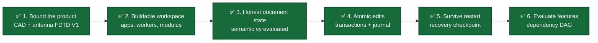
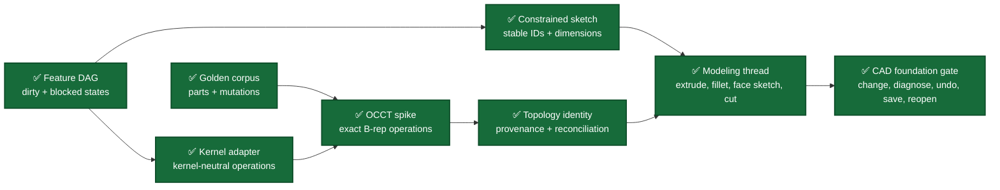
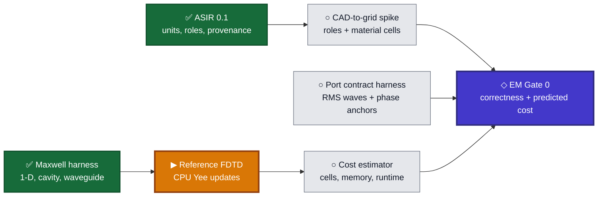
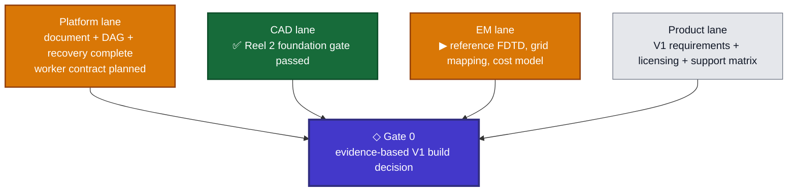

# Development Storyboard

**Status date:** October 9, 2026

**Current frame:** The Maxwell verification harness is verified. Implement the FP64 reference CPU Yee update loop against its frozen acceptance contract.

This storyboard translates the [architecture and development plan](implemention_plans/Fusio360_Vive_CAD_Architecture_and_Development_Plan.md) into visible product scenes. A completed panel means its stated evidence exists and passes; the panels are not equal in effort, so their count is not a project-completion percentage.

## Status legend

| Mark | Meaning |
|---|---|
| ✅ | Implemented and verified |
| ▶ | Current development target |
| ◇ | Planned decision gate |
| ○ | Planned implementation |

## Reel 1 — Establish a trustworthy foundation

| Scene | What becomes visible | Acceptance evidence | Status |
|---|---|---|---|
| Product boundary | A desktop-first mechanical CAD and broadband antenna FDTD V1 with explicit deferrals | Architecture plan and resolved state, optimization, and multiport contracts | ✅ |
| Buildable workspace | CAD Studio, EM Studio, model engine, and simulation worker compile from one preset | CMake/Ninja debug build and four process smoke tests | ✅ |
| Honest document state | A valid edit may fail regeneration without lying about which geometry is current | Separate semantic/evaluated revisions, typed `CurrentGeometryUnavailable`, repair and undo/redo tests | ✅ |
| Atomic edits | Several parameter edits commit as one revision or none of them apply | Typed transaction validation, immutable revisions, append-only command journal, replay validation | ✅ |
| Restart recovery | A failed or repaired document can be written, replaced atomically, and reopened | Versioned internal checkpoint, checksum and bounds checks, durable sibling-file replacement | ✅ |
| Feature evaluation | Editing one feature dirties and evaluates only its dependents in deterministic order | DAG cycle rejection, dirty propagation, blocked descendants, independent-branch preservation | ✅ |

Current implementation evidence:

- [Document state and transaction API](../modules/platform/document/include/oep/document/document.hpp)
- [Document state-machine implementation](../modules/platform/document/src/document.cpp)
- [Recovery-checkpoint API](../modules/platform/persistence/include/oep/persistence/checkpoint.hpp)
- [Document behavior tests](../tests/unit/document_state_machine_test.cpp)
- [Persistence and corruption tests](../tests/unit/persistence_checkpoint_test.cpp)
- [Feature DAG scheduler and transaction implementation](../modules/platform/document/src/document.cpp)
- [Feature dependency, failure, recovery, and cycle tests](../tests/unit/feature_dependency_graph_test.cpp)

## Reel 2 — Reach the first end-to-end CAD scene

The first CAD reel ends with this user-visible story:

> Create a constrained sketch → extrude → add a fillet → attach a sketch to the fillet result → cut a hole → change the first dimension → preserve or diagnose every reference → intentionally create a failed regeneration → save and reopen that state → repair or undo it → reproduce the valid model.

| CAD foundation panel | Engineering content | Done when |
|---|---|---|
| ✅ Feature DAG | Stable feature IDs, typed dependencies, deterministic topological ordering, minimal dirty subgraph | Verified by the [feature dependency graph test](../tests/unit/feature_dependency_graph_test.cpp): independent branches remain clean, cycles are rejected before commit, failures block descendants, and failed state survives save/reopen plus undo/redo |
| ✅ Golden corpus | Representative valid, degenerate, topology-changing, attached-sketch, recovery, cancellation, and parameter-sweep fixtures | The [shared nine-case corpus](../tests/golden/cad/kernel_corpus.cpp) produces comparable reports from both adapters; its coverage is recorded in the [corpus guide](../tests/golden/cad/README.md) |
| ✅ Kernel adapter | Exact-body handles, operation requests/results, provenance, diagnostics, snapshots, and cancellation boundary | The [kernel-neutral contract](../modules/cad/modeler/include/oep/modeler/kernel_adapter.hpp) and [deterministic fake](../tests/golden/cad/fake_geometry_kernel.cpp) pass the [contract suite](../tests/golden/cad/kernel_adapter_contract_test.cpp) |
| ✅ OCCT spike | Extrude, cut, fillet, pattern, attached sketch support, healing, and exact-body snapshots | The [OCCT exact B-rep adapter](../modules/cad/modeler/src/occt_geometry_kernel.cpp) passes the [same corpus](../tests/golden/cad/occt_kernel_adapter_contract_test.cpp), including typed failures and deterministic snapshot restoration |
| ✅ Topology identity | Generated/modified/deleted provenance, signatures, confidence, and ambiguity | The [persistent identity service](../modules/cad/topology_id/include/oep/topology_id/topology_identity.hpp) and [adversarial unit suite](../tests/unit/topology_identity_test.cpp) reject silent reassignment; the [shared mutation corpus](../tests/golden/cad/topology_mutation_corpus.cpp) passes against fake and OCCT adapters |
| ✅ Constrained sketch | Stable entity IDs, geometric constraints, dimensions, and solver diagnostics | The [sketch contract and deterministic solver](../modules/cad/sketch/include/oep/sketch/sketch.hpp) pass the [classification and identity suite](../tests/unit/sketch_solver_test.cpp): parameter changes preserve IDs and under-, fully-, over-, and inconsistently constrained cases remain distinct |
| ✅ Modeling thread | Sketch and feature commands connected through the document evaluator and checkpoint path | The [CAD feature evaluator](../modules/cad/modeler/include/oep/modeler/cad_feature_evaluator.hpp) composes sketch → extrude → fillet → attached sketch → cut, with every upstream topology decision retained as a typed evaluation diagnostic |
| ✅ CAD foundation gate | Parameter change, reference recovery, failed regeneration, restart, repair, undo/redo, and deterministic reopen | The [shared headless acceptance corpus](../tests/golden/cad/modeling_thread_corpus.cpp) passes against the deterministic fake and the OCCT exact B-rep adapter; explicit restart hydration follows [ADR 0001](architecture/decisions/0001-explicit-cad-evaluator-hydration.md) |

## Reel 3 — Develop the EM path in parallel

The first EM reel ends with this user-visible story:

> Tag CAD entities with EM roles → generate validated ASIR → inspect grid and resource estimates → run a reference FDTD case → store normalized immutable results → change a CAD-authoritative parameter in an isolated candidate → promote it through a guarded transaction → rerun and compare both result sets.

| EM foundation panel | Engineering content | Done when |
|---|---|---|
| ✅ ASIR 0.1 | Evaluated-CAD authority, dimensioned SI values, exact-body references, persistent EM roles, materials, ports, boundaries, solver/mesh policy, budgets, monitors, goals, provenance, and content identity | The [compiled ASIR contract](../modules/em/simulation_ir/include/oep/simulation_ir/simulation_ir.hpp), [versioned schema](../schemas/simulation_ir/asir-0.1.md), and [validation suite](../tests/unit/simulation_ir_test.cpp) accept a complete antenna study and reject stale/failed CAD state, missing topology, duplicate ports, unspecified dimensions, invalid material bands, and authority violations; fingerprints are canonical SHA-256 values |
| ✅ Maxwell harness | Independent analytic fixtures and error metrics for one-dimensional propagation, rectangular cavity, and waveguide modes | The [compiled oracle](../tests/golden/em/include/oep/test/maxwell_harness.hpp) and [canonical cases](../tests/golden/em/maxwell_harness.cpp) freeze analytic values, typed invalid-mode and cutoff failures, convergence criteria, conservation checks, and restart expectations; the [contract suite](../tests/golden/em/maxwell_harness_test.cpp) verifies the formulas and assessment behavior documented in the [harness guide](../tests/golden/em/README.md) |
| ▶ Reference FDTD | Double-precision CPU Yee updates, stable time step, sources, probes, PEC/open boundaries, and restart | The Maxwell fixtures converge within their declared per-case tolerances |
| Port contract harness | Versioned RMS power-wave, orientation, phase-anchor, reference-plane, and reconstruction conventions | Analytic four-port reconstruction, passivity, reciprocity, and reference-plane shift fixtures pass |
| CAD-to-grid spike | Persistent roles and material regions converted into traceable Cartesian cells | Cell/material/port mappings retain CAD IDs and report unresolved geometry and staircasing risks |
| Cost estimator | Cell, memory, time-step, runtime, and storage prediction with hard budgets | Predicted scaling and tiny-feature impact are checked against measured reference runs |

## Gate 0 convergence

Gate 0 is reached only when all four lanes provide evidence. A polished shell or isolated geometry demo does not satisfy the gate.

## Current development frame

The Maxwell harness now fixes the independent standard that the reference solver must meet:

1. Lossless plane-wave references calculate phase velocity, wavelength, impedance, and wavenumber from frequency and relative material constants.
2. Rectangular PEC-cavity references calculate TE/TM eigenfrequencies with valid modal-index rules; rectangular-waveguide references calculate cutoff, propagation constant, guide wavelength, phase/group velocity, and mode impedance.
3. Invalid materials and mode indices, nonpositive dimensions, nonfinite inputs, and operation at or below waveguide cutoff produce typed diagnostics rather than usable reference values.
4. Reusable metrics cover scalar relative error, relative field L2 error, absolute L-infinity error, observed refinement order, and normalized energy residual.
5. The plane-wave, TM111 cavity, and WR90 TE10 cases declare independent phase/frequency/propagation and field limits. Every case also requires energy accounting, observed convergence order of at least 1.8, and FP64 restart agreement within `1e-12` L-infinity error.
6. Case assessment rejects missing, duplicate, nonfinite, and out-of-tolerance observations. Analytic identities, scale behavior, negative paths, metric calculations, and assessment failures are compiled tests.
7. All 14 default and 17 OCCT-enabled checks pass in normal and ASan/UBSan builds. The harness remains in the golden test tree and has no dependency on future solver internals.

The active panel is the reference FDTD engine: implement the minimal FP64 CPU Yee field state, Courant-stable stepping, analytic-case sources and probes, PEC/open boundary behavior, and restart state needed to produce the harness observations. No numerical field solver exists yet.

## Progress snapshot

| Area | Present state |
|---|---|
| Build | C++20 CMake/Ninja monorepo; four process targets; optional locally bootstrapped OCCT build |
| Compiled libraries | `oep::document`, `oep::persistence`, `oep::sketch`, `oep::modeler`, `oep::topology_id`, `oep::cad_feature_model`, `oep::simulation_ir`, and optional `oep::occt_geometry_kernel` |
| Automated checks | Default preset: fourteen CTest entries; OCCT preset: seventeen entries including ASIR validation, the Maxwell oracle, exact-kernel, topology-mutation, and full modeling-thread coverage |
| Strictness | Warnings treated as errors; default and OCCT builds pass; all 14 default and 17 OCCT-enabled checks pass ASan/UBSan with leak checking disabled under the traced test environment |
| Data safety | Typed stale-geometry denial, DAG and journal replay validation, bounded checkpoint decoding, checksum verification, atomic replacement |
| Feature evaluation | Stable feature IDs and typed inputs; deterministic topological scheduling; minimal dirty propagation; blocked descendants; atomic cycle rejection |
| Geometry capability | Deterministic constrained sketches; kernel-neutral exact-body features; persistent topology decisions; restart-safe sketch → extrude → fillet → attached sketch → cut evaluation |
| Desktop capability | Process entry points exist; Qt UI and viewport are not implemented yet |
| EM capability | Validated, fingerprinted ASIR 0.1 and the independent analytic Maxwell acceptance harness are complete; the FP64 reference CPU FDTD engine is the active work |

## Updating this storyboard

When a panel completes:

1. Change its mark only after the acceptance evidence passes.
2. Link the implementation and the test that demonstrates the behavior.
3. Move the current marker to the next dependency-ready panel.
4. Update the progress snapshot without interpreting panel count as percent complete.
5. Record architecture-changing decisions in `docs/architecture/decisions/`.
