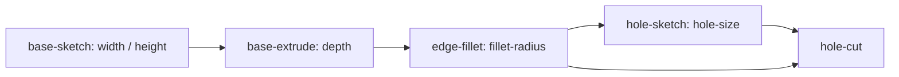

# CAD Software Design Description

**Baseline:** October 12, 2026 · revision 2

## Decomposition

| Component | Responsibility |
|---|---|
| `sketch` | Stable 2-D entity/constraint identities, dimension bindings, deterministic constraint solving |
| `modeler/kernel_adapter` | Kernel-neutral exact-body operations, cancellation, diagnostics, provenance, inspection/snapshots, disposable display tessellation |
| `modeler/occt_geometry_kernel` | OCCT B-rep implementation hidden behind project-owned types |
| `topology_id` | Persistent identity reconciliation using provenance and geometric signatures |
| `modeler/cad_feature_evaluator` | Document evaluator composing sketches, kernel operations, topology decisions, and hydration |

The evaluator borrows a kernel and owns feature artifacts. The kernel owns exact bodies identified by transient handles. Persistent feature/local IDs belong to document/topology contracts and cannot be replaced by kernel enumeration indices.

## Example feature and parameter model

The implemented desktop example has five features and five CAD-authoritative parameters:

The diagram summarizes the modeling thread, not every named dependency input. The authoritative declarations are in `make_reel2_cad_model()`. Example dimensions are millimeters. Conversion to SI belongs to the study draft boundary, not to an implicit kernel unit assumption.

The UI currently edits declared parameters of selected existing features. Native face picking returns persistent topology IDs from the final evaluated body. General sketch/entity creation, arbitrary feature insertion, and assembly editing remain unfinished.

## Sketch solver design

Definitions contain stable point/line/circle IDs and geometric/dimensional constraints. Model indexing maps variables to deterministic coordinates/radii, validates references and degenerate inputs, and constructs residual/Jacobian information.

The solver iterates damped normal equations. Damping regularizes singular or ill-conditioned systems; backtracking accepts residual reduction. The current iteration cap is 80, solve tolerance is `1e-9`, and rank tolerance is `1e-8`. These are implementation parameters, not generic guarantees for every scale of CAD model.

Final constraint/rank analysis distinguishes under-constrained, fully constrained, over-constrained, inconsistent, and invalid cases. Small residual alone does not prove full constraint. Downstream exact construction must inspect solver status and diagnostics. Changing residual definitions, rank tolerances, or parameter binding requires the sketch classification and identity tests.

## Exact kernel boundary

Requests cover extrusion, boolean cut, fillet, linear pattern, healing, planar face access, body summaries, topology inspection, display tessellation, and snapshot restoration. Project types describe points/vectors, profiles, topology descriptors, generated/modified/deleted provenance, and typed operation failures. The OCCT adapter contains native OCCT types and translates exceptions/results into this boundary.

Cancellation tokens share an atomic flag with a source. They indicate cancellation only; the relaxed atomic is not a general payload synchronization mechanism. Operations must retain their defined cancellation checks. Caller-visible body handles are scoped to the kernel instance and cannot be reused after reopening.

## Topology identity

A persistent ID combines feature identity with a local value. Bindings retain source ancestry and geometric information. Reconciliation considers operation provenance, semantic roles, compatible geometry, and signatures including measures, centroids, orientation, bounds, and adjacency.

A plausible similarity score does not grant identity. Deleted entities, competing candidates, and low/ambiguous confidence generate explicit decisions/diagnostics. The evaluator passes these decisions into document feature diagnostics so checkpoints and support reports preserve the reason a reference failed.

The EM controller lists only resolved faces from the final body's topology bindings. Upstream faces deleted by later operations must not appear as available study targets. The viewport resolves picks to this same persistent-ID namespace; EM authoring remains selector-based until selected faces are wired directly into role/port commands.

## Incremental evaluation

The document scheduler provides semantic state, the feature definition, and named upstream output hashes. The evaluator looks up compatible artifacts, solves feature sketches, invokes the kernel, reconciles topology, and returns output hashes/diagnostics. Successful final composition establishes the document geometry content hash. Missing artifacts, sketch failures, invalid exact operations, or unresolved mandatory references must propagate failure rather than invent outputs.

Clean branches may reuse artifacts within the evaluator lifetime. Persisted clean output hashes alone are insufficient in a fresh process: the corresponding body and sketch/topology artifacts must be rebuilt.

## Explicit hydration and restart

Hydration rebuilds artifacts for persisted revisions and verifies evaluator identity, feature states, hashes, diagnostics, and composed geometry. Failed semantic heads still need compatible clean upstream artifacts so later repair can work. A mismatch rejects the candidate session. `Document::restore` itself does not call the evaluator.

The Qt checkpoint loader constructs a fresh candidate session, validates restored value state, hydrates its evaluator, and swaps it into the controller only after success. The kernel/evaluator/document lifetime group is then retained as the active CAD session. [ADR 0001](../decisions/0001-explicit-cad-evaluator-hydration.md) records the separation of hydration and restoration.

Hydration cost grows with stored history. Future compatible exact-body caching must validate evaluator/build/content authority and cannot bypass reference reconciliation.

## Error handling and extension constraints

| Failure | Design behavior |
|---|---|
| Invalid or inconsistent sketch | Typed sketch status/diagnostics; no valid feature output |
| Invalid exact operation | Kernel failure diagnostics; document commits valid semantic edit as failed regeneration |
| Deleted/ambiguous attachment | Typed reconciliation diagnostics; no silent nearest-face reassignment |
| Missing restored artifact | Explicit hydration/compatibility failure |
| Failed descendant | Block downstream evaluation while preserving independent clean branches |

Add modeling operations through kernel-neutral request/result contracts and both adapter corpora. Add feature semantics through the evaluator and document dependency graph. Preserve stable IDs, operation provenance, failure diagnostics, restart verification, and the fake-versus-OCCT comparison path. Native rendering should consume evaluated geometry without becoming document authority.

## Implementation reference inventory

### `modules/cad/sketch`

- [sketch.hpp](../../../modules/cad/sketch/include/oep/sketch/sketch.hpp) — `modules/cad/sketch/include/oep/sketch`
- [sketch.cpp](../../../modules/cad/sketch/src/sketch.cpp) — `modules/cad/sketch/src`

### `modules/cad/modeler`

- [cad_feature_evaluator.hpp](../../../modules/cad/modeler/include/oep/modeler/cad_feature_evaluator.hpp) — `modules/cad/modeler/include/oep/modeler`
- [kernel_adapter.hpp](../../../modules/cad/modeler/include/oep/modeler/kernel_adapter.hpp) — `modules/cad/modeler/include/oep/modeler`
- [occt_geometry_kernel.hpp](../../../modules/cad/modeler/include/oep/modeler/occt_geometry_kernel.hpp) — `modules/cad/modeler/include/oep/modeler`
- [cad_feature_evaluator.cpp](../../../modules/cad/modeler/src/cad_feature_evaluator.cpp) — `modules/cad/modeler/src`
- [kernel_adapter.cpp](../../../modules/cad/modeler/src/kernel_adapter.cpp) — `modules/cad/modeler/src`
- [occt_geometry_kernel.cpp](../../../modules/cad/modeler/src/occt_geometry_kernel.cpp) — `modules/cad/modeler/src`

### `modules/cad/topology_id`

- [topology_identity.hpp](../../../modules/cad/topology_id/include/oep/topology_id/topology_identity.hpp) — `modules/cad/topology_id/include/oep/topology_id`
- [topology_identity.cpp](../../../modules/cad/topology_id/src/topology_identity.cpp) — `modules/cad/topology_id/src`

