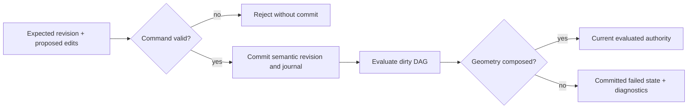

# Platform Software Design Description

**Baseline:** October 12, 2026 · revision 2

## Responsibilities and dependencies

The platform document module owns semantic history and evaluation authority. Persistence converts document value state to an internal recovery format and replaces files atomically. IPC provides generic versioned framing. These modules do not depend on Qt or OCCT types; a supplied `Evaluator` performs domain-specific regeneration.

## Document data model

| Type | Meaning and lifetime |
|---|---|
| `RevisionId`, `FeatureId` | Stable value identifiers for revisions/features |
| `SemanticState` | Ordered map from parameter ID to finite numeric model value |
| `FeatureDefinition` | Feature ID, parameter dependencies, named upstream inputs |
| `DocumentRevision` | Semantic state and feature graph with parent revision |
| `EvaluationRecord` | Evaluator version, feature states/hashes, diagnostics, optional geometry hash |
| `DocumentState` | Revisions, timeline/cursor, journal, evaluations, evaluated revision, last-good snapshot, next ID |
| `GeometryAccess` | Optional current snapshot or typed unavailable diagnostic |

`Document` borrows its evaluator; the evaluator must outlive the document. References/spans passed during evaluation belong to the call; implementations must not retain dangling views into requests. The module is an in-memory state machine, not a persistence scheduler or multi-threaded service. New documents require a successfully evaluated initial state; failed later revisions can be restored through validated history. Empty, duplicate, and no-effective-change transaction proposals are rejected rather than creating artificial revisions.

## Command processing

`SetParameterCommand` is a single-edit convenience interface. `CommandTransaction` carries an expected revision, parameter changes, and dependency additions. A transaction rejects stale revision, malformed/unknown parameters, invalid values, or invalid dependency structure before commit.

A committed command and a successful evaluation are different outcomes. Callers inspect `CommandResult.status` and `evaluation_succeeded` separately. Treating a geometry failure as a rejected command would hide the new semantic authority and break repair/undo semantics.

## Dependency scheduling

The feature graph must identify existing features and form a DAG. Deterministic topological traversal uses stable IDs to break ready-node ties. Dirty propagation begins at changed parameter owners or graph changes and follows downstream dependencies. Clean independent branches reuse valid outputs. Failed features prevent dependent evaluation, producing blocked descendants. Final geometry is available only when the current evaluation succeeds.

Feature state vocabulary is `clean`, `dirty`, `evaluating`, `succeeded`, `failed`, and `blocked`. Clean and succeeded are successful states. A persisted output hash is provenance for an artifact, not proof that a kernel object exists in a fresh evaluator.

## Undo, redo, and restoration

Undo/redo move the active timeline cursor; revision history and journal retain identity. New commands after Undo select a new forward history path. Consumers must obtain the current revision again rather than cache earlier expected IDs.

`Document::restore` validates stored history, graph, journal replay, evaluation records, and authority relationships without secretly regenerating CAD. Exact CAD artifacts are rebuilt through explicit evaluator hydration. See [ADR 0001](../decisions/0001-explicit-cad-evaluator-hydration.md). The current Qt loader validates value state with restore, then hydrates the candidate evaluator, and activates only after both succeed; the ADR's intended hydration-before-restore ordering is not material to validation-only restore, but both gates must precede activation.

## Recovery format

`encode_document_checkpoint` serializes `DocumentState`; `decode_document_checkpoint` rejects malformed, unsupported, corrupt, oversized, or trailing data. The current implementation uses checkpoint version 2 and a 28-byte header. Limits default to 64 MiB payload, one million collection entries, and 1 MiB strings. These limits constrain separate allocation sources and must not be treated as interchangeable.

The format stores history, journal, semantic/evaluation state, diagnostics, and authority hashes. It does not store Qt layout, EM draft settings, or portable live kernel handles. Decode verifies binary integrity; `Document::restore` verifies semantic consistency. Neither one substitutes for explicit CAD hydration.

### Atomic replacement

Saving writes a sibling temporary file and publishes it through the platform replacement path. POSIX implementation synchronizes file contents before rename and synchronizes the parent directory after rename. Windows uses its corresponding file/replacement primitives. Errors propagate to the caller; support code should retain the active in-memory document and show the file error. An error after rename may occur after the destination has changed, so callers must not promise the old on-disk file survived every failure.

Recovery files are internal checkpoints, not the planned public native package. Any schema or field-order change needs versioning and migration/rejection tests. Checksums detect accidental corruption, not malicious authenticity.

## Compound recovery extension

`save_checkpoint_bytes_atomic` exposes the existing durable replacement path to compound recovery helpers. The EM-owned project helper stores CAD recovery bytes with document identity and an optional complete ASIR value; project v2 may append an opaque nested worker-protocol restart record. Platform persistence interprets neither ASIR nor worker state. Desktop activation validates the nested job/checkpoint only after document restore and exact-kernel hydration have succeeded. See [ADR 0010](../decisions/0010-atomic-cad-study-project-recovery.md) and [ADR 0013](../decisions/0013-atomic-worker-recovery-in-project-checkpoint.md). Existing CAD-only encoding and project-v1 reading remain unchanged.

## Generic IPC

`Frame` contains message type, correlation ID, and byte payload. Frame protocol version is 1. Individual frames and streams carry magic/version/integrity structure. Receivers enforce maximum payload (default 64 MiB) and frame count (default 4096), reject truncated/trailing data, and expose typed diagnostics.

The worker protocol adds its own contract version, command semantics, and nested bounds. A successfully decoded frame may still contain an invalid worker payload. Correlation IDs associate responses with requests; they are not authentication credentials or job identities.

## Failure and support contracts

| Symptom | Meaning | Required consumer response |
|---|---|---|
| Rejected stale edit | Expected revision differs from active authority | Refresh values and issue a deliberate new command |
| Committed regeneration failure | New semantic state lacks current geometry | Display diagnostics; allow repair/undo; block current-geometry consumers |
| Restore failure | Persisted values/history violate contract | Preserve active session; report incompatibility/corruption |
| Hydration mismatch | Persisted evaluation cannot be reproduced by candidate evaluator | Reject activation; do not silently trust hashes |
| Checkpoint I/O error | Read/write/replace/durability operation failed | Report exact error; do not claim a completed save |
| Frame/payload error | Local message is malformed or outside receiver policy | Reject dispatch and report typed protocol diagnostics |

## Change constraints

Preserve validation-only restore, expected-revision checks, deterministic scheduling, and current-geometry denial. Coordinate persistence versions with state-model changes. Extend IPC types through versioned payload contracts. Do not place QML or OCCT objects in `DocumentState`.

## Implementation reference inventory

### `modules/platform/document`

- [document.hpp](../../../modules/platform/document/include/oep/document/document.hpp) — `modules/platform/document/include/oep/document`
- [document.cpp](../../../modules/platform/document/src/document.cpp) — `modules/platform/document/src`

### `modules/platform/persistence`

- [checkpoint.hpp](../../../modules/platform/persistence/include/oep/persistence/checkpoint.hpp) — `modules/platform/persistence/include/oep/persistence`
- [checkpoint.cpp](../../../modules/platform/persistence/src/checkpoint.cpp) — `modules/platform/persistence/src`

### `modules/platform/ipc`

- [README.md](../../../modules/platform/ipc/README.md) — `modules/platform/ipc`
- [frame.hpp](../../../modules/platform/ipc/include/oep/ipc/frame.hpp) — `modules/platform/ipc/include/oep/ipc`
- [frame.cpp](../../../modules/platform/ipc/src/frame.cpp) — `modules/platform/ipc/src`

