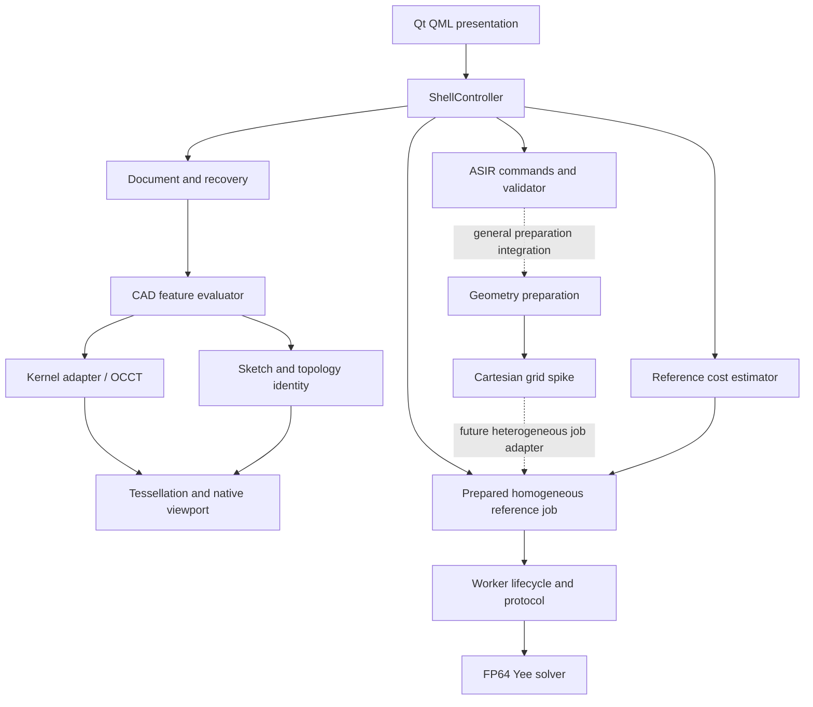

# System Software Design Description

**Baseline:** October 12, 2026 · revision 4

## Purpose and scope

EMS Studio develops a desktop-first mechanical CAD and antenna FDTD platform. The implemented foundation consists of a revisioned document engine, exact CAD adapter, validated study representation, limited geometry/grid preparation, FP64 reference numerical engine, and restartable reference worker. The native Qt shell exposes CAD editing, EM setup, native assembly display, and an in-process reference worker experience. The web UI is an interaction reference.

This SDD covers the implemented boundaries. Production GPU/MPI execution, arbitrary B-rep meshing, calibrated ports, normalized result storage, and assembly-scale GPU viewport rendering remain outside the implemented baseline.

## Context and deployment

| Executable/surface | Current responsibility | Integration boundary |
|---|---|---|
| `cad-studio` | Starts the shared shell in CAD mode | In-process controller and document commands |
| `em-studio` | Starts the shared shell in EM mode | Same host; a separate launch has its own session |
| `model-engine` | Engine process target and smoke boundary | Long-lived desktop document service remains unfinished |
| `simulation-worker` | Reference job execution and bounded batch protocol harness | Framed typed worker requests/replies |
| `apps/ui_wireframe` | Dependency-free browser interaction prototype | Does not edit compiled documents or execute the solver |

Qt and OCCT are optional build dependencies. A non-Qt build uses a headless application host. `qt-shell` enables Qt presentation without OCCT document creation/loading; `qt-cad` enables the functional CAD example and exact-body viewport path.

## Component decomposition

Solid arrows express implemented dependencies/workflows. Dotted arrows identify incomplete product integration. The desktop worker's bounded homogeneous preview grid is not the heterogeneous grid mapping produced by the CAD-to-grid spike.

## Authority and ownership

| Resource | Owner | Consumers and restrictions |
|---|---|---|
| Revision history, journal, evaluation records | `document::Document` | UI obtains projections and sends expected-revision commands |
| Exact bodies and transient handles | Kernel instance | Evaluator retains artifacts; handles cannot survive process restart |
| Reconciled feature/local topology IDs | CAD topology/evaluator contracts | Study references retain IDs and expected entity kinds |
| Immutable display scene | Tessellation module from current exact body | Qt camera/rendering and hit testing; disposable, never document authority |
| EM draft | Shell session | Study commands use fingerprint and live document authority |
| Solver fields and execution progress | Reference worker/grid | Protocol exposes value state and artifacts, not field pointers |
| Desktop prepared job/checkpoint/artifacts | Shell session plus optional project-v2 restart record | Invalidated by CAD/ASIR mutation; nested authority revalidated before restore |
| Layout settings | Qt controller/QSettings | Versioned settings, bounded dimensions; no document persistence |

The owned CAD session keeps kernel, evaluator, and document lifetimes together. The alternate attachment API borrows a document and requires host-managed lifetime and refresh. No API documented here implies concurrent access is safe; callers must serialize mutation and respect the owning thread/process.

## End-to-end scenarios

### CAD edit and recovery

Create the five-feature example, evaluate it with OCCT, and publish a tessellated scene whose primitives carry reconciled persistent IDs. Select a feature and submit a parameter edit carrying the expected revision. Invalid commands do not commit. Valid semantic edits commit even when regeneration fails. Failed geometry is denied through `current_geometry()` and clears the viewport. Undo or repair restores evaluated authority and rebuilds the scene. Checkpoint loading builds a separate restored/hydrated session and replaces the active session only after success.

### EM authoring

Prepare a draft only from current evaluated example geometry. Convert example millimeters to SI meters and capture document ID, revisions, and geometry hash. Author materials, resolved face roles, discrete ports, boundary policies, and network/impedance monitor requests through compiled commands. Full validator diagnostics remain visible. CAD changes preserve the old draft as stale; rebuilding resets authored setup. Compound project recovery preserves CAD history and all authored study fields, while CAD-only checkpoints still omit the draft.

### Reference worker acceptance

The Worker tab binds a structurally complete study to the reference build and execution provenance, displays a calibrated estimate, prepares a bounded homogeneous preview job, and runs it in bounded slices. Cancellation is terminal; checkpoints resume in a fresh worker object; successful collection returns raw provenance-bearing artifacts. Project-checkpoint v2 atomically stores an optional job/checkpoint beside CAD and ASIR and stages exact resume before desktop activation. Independent protocol acceptance additionally proves worker restart across a fresh process.

## Cross-cutting qualities

- **Correctness:** Separate semantic/evaluated authority and independent Maxwell/port analytic contracts prevent false success.
- **Reproducibility:** Stable dependency ordering, canonical study fingerprints, kernel/evaluator identity checks, and exact field checkpoints preserve traceability.
- **Recoverability:** Atomic CAD checkpoint replacement and worker resume protect independent state domains; they do not form an atomic CAD+study+job package.
- **Resource control:** Geometry, grid, decoding, and execution estimates apply bounded policies before expensive allocation.
- **Maintainability:** Public headers define module contracts; comments explain local invariants; SDDs explain composition; ADRs explain material decisions.
- **Security boundary:** Integrity checks detect corruption. They do not authenticate files, peers, or approvals; the implemented local harness is not a network service security design.

## Dependencies and release boundaries

CMake/Ninja builds C++20 components. Qt is pinned to 6.4.2 for this shell. OCCT is optional and isolated behind the kernel adapter. Consult the [dependency/license matrix](../../product/DEPENDENCY_LICENSE_MATRIX.md) and [compute support policy](../../product/COMPUTE_SUPPORT_POLICY.md) for distribution constraints and planned execution profiles. Project-owned code/documentation uses root MIT licensing. Release SBOM/notices and performance qualification remain release work.

## Design gaps

The current public interfaces establish many future integration seams, but do not supply a general CAD feature authoring UI, GPU-resident large-assembly renderer, arbitrary CAD-to-FDTD pipeline, long-lived supervised worker service, normalized result database, or production parallel solver. Native assembly/LOD projection meets the storyboard's one-million-source-triangle CPU boundary, and Worker Experience recovery now survives a fresh desktop session. Heterogeneous CAD-to-worker preparation is the active integration gap.
