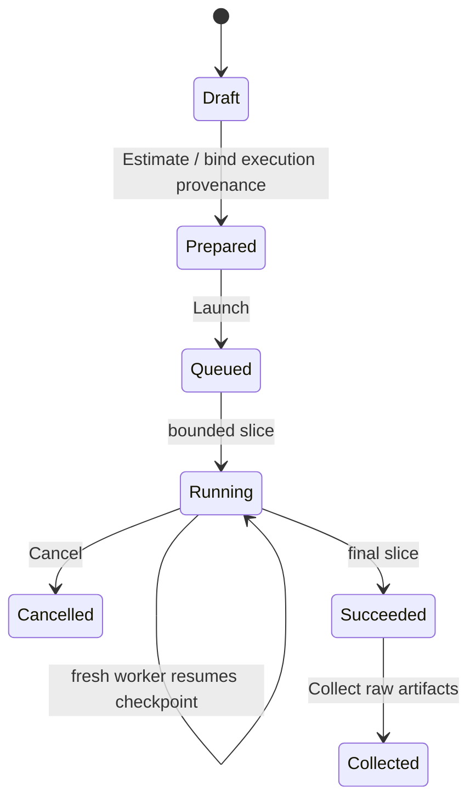

# Worker Experience Software Design Description

**Baseline:** October 12, 2026 · revision 2

## Scope and user workflow

The Worker tab exposes the reference worker lifecycle from a structurally complete EM study: calculate a bounded estimate, launch, observe authoritative progress, cancel, checkpoint, restart in a fresh worker object, and collect provenance-bearing raw artifacts. This is an interactive reference path for the supported CAD example. It is not the production CAD-to-grid pipeline, a calibrated antenna solve, normalized result storage, or a supervised external service.

## Authority and preparation

`ShellController::can_prepare_worker` accepts a current study only when the remaining validator errors are the intentionally deferred solver-build and execution-provenance fields. Estimate then copies the study, binds the compiled reference-worker build ID, records checksum/host/time/user approval and the preparation operation, validates the complete ASIR, and commits the execution-ready copy. The resulting canonical study fingerprint is captured by the immutable prepared job.

The preview grid is a bounded `12 × 10 × 8` homogeneous domain derived from the supported example's SI width, height, and depth. `ReferenceFdtdCostEstimator` computes cells, Courant-limited steps, peak memory, checkpoint/storage bytes, and a conservative runtime from the named `interactive-reference/single-thread` calibration. Worker validation runs before solver allocation. The UI displays the immutable estimate and enables Launch only after validation.

This preparation deliberately does not claim that authored face roles, PML policy, or ports have been converted into a heterogeneous numerical model. The general CAD-to-grid adapter and calibrated solver ports require their own product integration and evidence.

## Runtime lifecycle

The Qt timer requests bounded `run_slice` operations; the worker remains the source of truth for phase, completed steps, total steps, and progress. Cancellation goes through the lifecycle contract and reaches an explicit terminal `cancelled` phase. A checkpoint contains exact solver state plus job, study, build, grid, and completed-step authority. Restart constructs a fresh `ReferenceSimulationWorker` and accepts state only after the worker verifies that authority. Collection is allowed only after success and exposes the raw final solver checkpoint with study/build provenance.

Document replacement, CAD edits, Undo/Redo, and study edits reset live worker state because their authority may differ from the prepared job. Saving a compound project captures the latest running checkpoint when possible and stores an optional durable worker record beside CAD and ASIR. CAD-only checkpoints still omit it.

## Durable recovery

Project-checkpoint v2 adds an optional opaque worker-recovery blob. The blob is a checksummed, versioned worker-protocol resume request containing the complete immutable prepared job and exact `CheckpointArtifact`; keeping it opaque prevents `simulation_ir` from depending on a worker implementation. Project v1 remains readable and restores without worker state.

Save uses the existing durable sibling-file replacement, so CAD history, document identity, complete ASIR, and the worker record advance as one file. Open stages every boundary before activation:

1. decode and checksum the bounded outer project frame;
2. restore document history and hydrate exact-kernel state in a candidate session;
3. require worker recovery to reference the project's current evaluated CAD authority;
4. decode the nested worker frame and require a resume operation with correlation ID zero;
5. compare the prepared-job fingerprint with canonical ASIR content and require the supported solver build;
6. construct a fresh worker and let `resume` validate job, estimate, grid, checkpoint identity, solver payload, and completed steps;
7. replace the active CAD, ASIR, and worker session only after every check passes.

Nested corruption, unsupported versions, wrong operation, ASIR mismatch, solver mismatch, stale/failed current geometry, and invalid solver state reject the complete load. The previously active desktop session remains unchanged.

## Presentation and threading

QML owns buttons, status text, progress presentation, and a 45 ms timer. It invokes controller methods and contains no solver rules. The current reference worker executes synchronously in-process on the Qt thread in short bounded slices. This keeps the baseline deterministic, but a large workload would block presentation. An asynchronous or external worker adapter must marshal updates back to the Qt owning thread and preserve the same value contracts.

## Failure behavior

| Condition | Result |
|---|---|
| Stale, failed, or incomplete study | Estimate disabled or rejected with validator diagnostics |
| Estimate outside a hard budget | Preparation fails or requires the declared approval path; no silent fidelity reduction |
| Job/build/grid identity mismatch | Worker rejects before execution or resume |
| Cancellation | Explicit terminal state; artifacts remain unavailable |
| Checkpoint mismatch/corruption | Fresh worker refuses resume |
| Collection before success | Rejected; no partial result is presented as final |
| CAD or ASIR mutation after preparation | Live job/checkpoint/artifacts are invalidated |
| Corrupt or mismatched durable worker record | Entire project load rejects before active-session replacement |

## Verification and remaining work

`app_shell_state_test` covers preparation, visible estimate, launch, progress, checkpoint, exact fresh-worker resume, completion, raw artifact collection, terminal cancellation, atomic project save, restoration in a fresh controller session, and load-before-activation rejection for nested corruption and ASIR mismatch. Project codec tests prove v1 compatibility and v2 opaque-worker round trip. Worker lifecycle tests prove the nested durable record's exact round trip, checksum rejection, and resume-only policy. The offscreen `cad-studio` and `em-studio` smoke paths invoke the visible Worker controls and actual File Save/Open recovery, while the independent real-process test continues to prove worker restart across a process boundary.

The Worker Experience storyboard panel is complete. Long-lived supervision, crash/disconnect/retry policy, external process status streaming, heterogeneous CAD-to-grid preparation, calibrated ports, normalized result browsing, and production CPU/GPU/MPI execution remain later capabilities.

## Implementation inventory

- [`shell_controller.hpp`](../../../modules/platform/app_shell/include/oep/app_shell/shell_controller.hpp) and [`shell_controller.cpp`](../../../modules/platform/app_shell/src/shell_controller.cpp) — preparation and UI lifecycle adapter
- [`Main.qml`](../../../modules/platform/app_shell/qml/Main.qml) — Worker tab, progress, and controls
- [`reference_worker.hpp`](../../../modules/em/simulation_orchestrator/include/oep/simulation_orchestrator/reference_worker.hpp) — worker lifecycle implementation
- [`solver_api.hpp`](../../../modules/em/em_solver_api/include/oep/em_solver_api/solver_api.hpp) — solver-neutral job/state/checkpoint/artifact contracts
- [`simulation_cost.hpp`](../../../modules/em/simulation_cost/include/oep/simulation_cost/simulation_cost.hpp) — resource estimate contract
- [`app_shell_state_test.cpp`](../../../tests/unit/app_shell_state_test.cpp) and [`application_qt.cpp`](../../../modules/platform/app_shell/src/application_qt.cpp) — controller and visible-control acceptance
