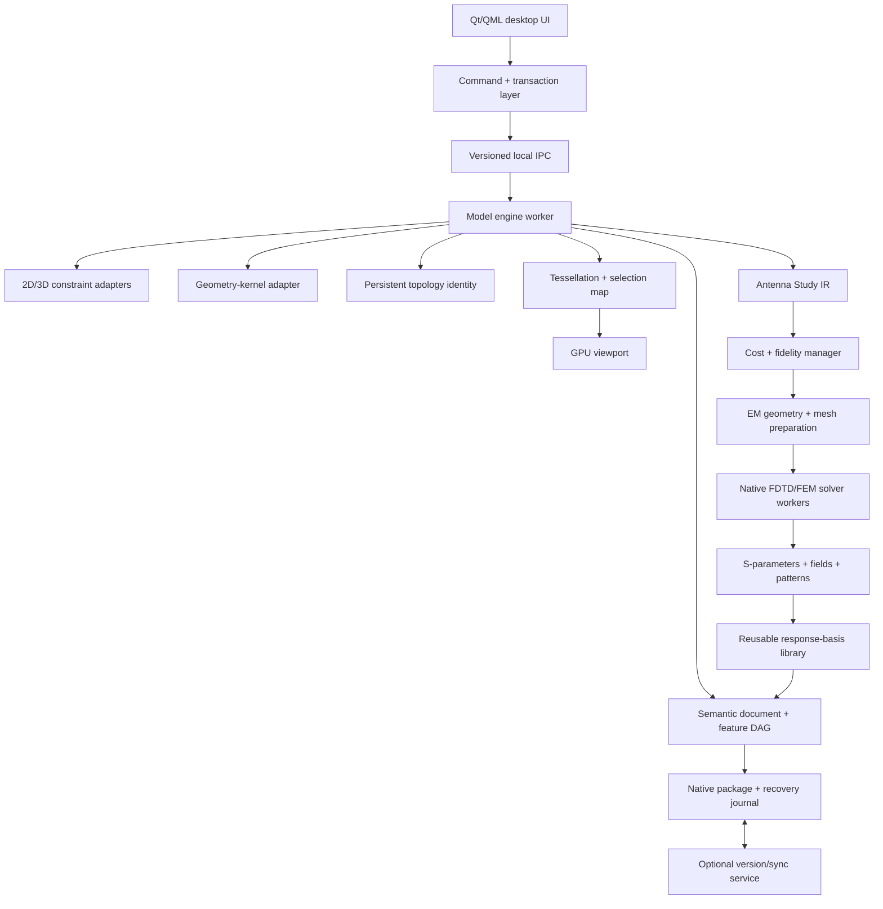
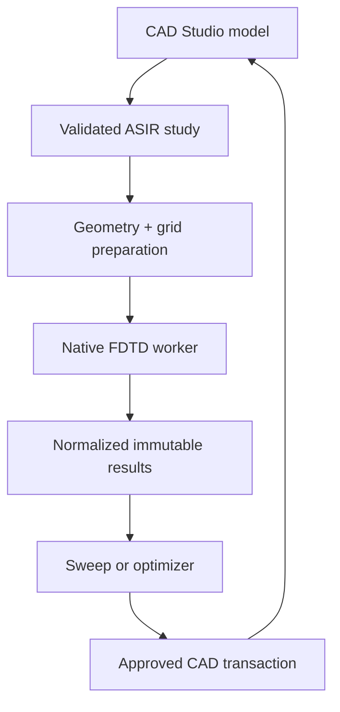

# Open Engineering Design Platform
## Clean-Sheet CAD and Electromagnetic Simulation Architecture and Development Plan

**Status:** Research and planning baseline  
**Date:** October 9, 2026  
**Objective:** Define a technically credible architecture and phased plan for two coordinated open-source applications: a modern Fusion-class mechanical CAD system and a clean-sheet CST-class electromagnetic design/simulation system, connected through a native parametric study interface without copying proprietary source code, algorithms, file formats, visual assets, APIs, or branding.

---

## 1. Executive recommendation

Build a coordinated **desktop-first, local/offline-capable, cloud/HPC-enhanced engineering platform** consisting of:

1. **CAD Studio:** parametric mechanical design, direct editing, assemblies, interoperability, and versioning.
2. **EM Studio:** clean-sheet antenna modeling, meshing, full-wave solution, optimization, and electromagnetic post-processing.

CST Studio Suite is a capability benchmark only. It is not a runtime dependency, connector target, code source, UI template, or compatibility requirement. The first EM product target should be a trustworthy broadband antenna solver, not immediate duplication of every high-frequency, low-frequency, particle, cable, circuit, thermal, and multiphysics capability in CST.

### Recommended production stack

| Layer | Recommended technology | Reason |
|---|---|---|
| Primary implementation language | **Modern C++ (C++20/23)** | Native match for commercial and open CAD kernels, constraint SDKs, Qt, graphics APIs, and existing engineering libraries; predictable memory layout and performance |
| Geometry kernel | **Open CASCADE Technology (OCCT)** as the open-source baseline; optional Parasolid adapter for separately licensed builds | OCCT permits an independently distributable open application; the adapter boundary preserves an optional robustness/interoperability path |
| 2D constraint solver | Evaluate and harden **FreeCAD PlaneGCS** under a compatible license; keep a solver adapter | Constraint solving, degrees-of-freedom analysis, conflict diagnosis and stable drag behavior remain specialized problems |
| 3D assembly constraints | Deliberately limited in-house joint solver for V1; optional D-Cubed adapter for separately licensed builds | Preserves an open baseline without letting assembly motion overwhelm part modeling |
| Desktop UI | **Qt 6, C++ plus QML/Qt Quick** | Cross-platform native application framework with strong desktop input, accessibility, localization, and graphics integration |
| Viewport | OCCT visualization for bootstrap, then an open renderer abstraction/custom GPU path; optional HOOPS adapter for separately licensed builds | Separates exact CAD geometry from GPU display meshes and keeps renderer replacement possible |
| Automation and plug-ins | **Python 3 API**, out of process where practical | Familiar to engineers, fast for macros and add-ins, and already accepted in the CAD ecosystem |
| Electromagnetic study interface | **Vendor-neutral Antenna Study IR shared by CAD Studio and EM Studio** | Carries geometry, parameters, materials, ports, boundaries, monitors, solver settings, goals, and results without file-format hand editing |
| Initial EM solver | **Clean-sheet 3-D FDTD in C++ with Kokkos-style CPU/GPU portability and MPI** | Broadband antenna results from one transient run; natural fit for GPU stencil computation and the initial sinuous/array use cases |
| Later EM solvers | **Frequency-domain FEM using MFEM/PETSc/hypre; later MoM/MLFMM, eigenmode, and asymptotic engines** | Adds conformal and electrically large problem classes without overloading V1 |
| Scientific visualization | **VTK-based field and result visualization; HDF5/XDMF-style result storage** | Handles large scalar/vector/complex field datasets independently of the CAD viewport |
| Cloud services | **Go** for ordinary APIs/sync/job orchestration; **C++ compute workers** for geometry and EM jobs | Go is productive for control-plane services; numerical work remains native |
| Web portal/viewer | TypeScript/React plus a WebGPU or commercial CAD web viewer | Appropriate for project administration, review, markup, and read-only visualization—not the first modeling engine |
| Data contracts | Protobuf or FlatBuffers with versioned schemas; shared memory for large local meshes | Stable process boundaries and efficient transfer without exposing C++ object layouts |

### Language decision

If one primary language must be selected, select **C++**. Rust is an excellent secondary language for isolated, security-sensitive services and file-processing tools, but it should not be the first-language foundation of this CAD product. The geometry kernels, mature CAD SDKs, Qt stack, and most engineering integration points are C or C++. A Rust-first design would add a large unsafe FFI boundary precisely around the most complex stateful objects in the application. Go is an excellent cloud-service language but a poor fit for the in-process geometry, viewport, and desktop CAD core.

This is intentionally a **small polyglot stack**, not a one-language ideology:

- C++ owns geometry, constraints, feature evaluation, meshing, EM solvers, numerical kernels, selection, tessellation, and both native desktop applications.
- QML expresses presentation and interaction states while business rules stay out of QML.
- Python exposes user automation and test scripting.
- Go owns cloud control-plane services only when those services are justified.
- TypeScript is reserved for the web portal and review client.

---

## 2. What “Fusion-class” actually includes

Autodesk describes Fusion as a combined product-development platform spanning sketching, parametric and direct solid modeling, surface/mesh/freeform modeling, assemblies, drawings, rendering, simulation, manufacturing, electronics, and cloud data management. Its parametric mode captures features and relationships in a timeline, while direct mode edits geometry without recording the same parametric history. This breadth is the key scope warning: it is not one application feature; it is a portfolio built on shared geometry and data infrastructure.

### Proposed product boundary

**Version 1 should include:**

1. Constrained 2D sketching
2. History-based parametric solid modeling
3. Limited direct face editing
4. Components and basic mechanical assemblies
5. STEP, IGES, STL, OBJ, and native-file interchange
6. Drawings sufficient for basic part documentation
7. Local files plus optional managed cloud versions
8. Python automation and a documented plug-in SDK
9. Native parametric handoff to the companion EM Studio application

**EM Studio Version 1 should include:**

1. Native ingestion of CAD geometry, stable parameter identities, materials, and EM roles
2. Structured-grid geometry preparation and FDTD mesh generation
3. A clean-sheet 3-D Yee-grid FDTD solver with CPU, NVIDIA GPU, and distributed-memory execution targets
4. PEC, PMC/symmetry, periodic where feasible, and convolutional PML/open boundaries
5. Isotropic conductors/dielectrics plus selected dispersive models
6. Lumped/discrete and basic waveguide/coaxial ports, plane-wave excitation, and field probes
7. S-parameters, impedance/VSWR, accepted power, efficiency, near fields, surface currents, and near-to-far-field transformation
8. Parameter sweeps, bounded optimization, immutable results, and Python automation
9. A vibe-coded study author that produces validated, reviewable study definitions rather than arbitrary solver code

**Explicitly defer:**

- CAM toolpath generation and post-processors
- Native structural FEA/CFD and unrestricted generative design
- Frequency-domain FEM, MoM/MLFMM, eigenmode, asymptotic/SBR/PO, low-frequency, cable, particle, circuit, thermal, and multiphysics solvers until after the FDTD antenna V1 is validated
- PCB/electronics integration
- T-spline/subdivision freeform modeling
- photorealistic cloud rendering
- real-time multi-author feature-tree editing
- enterprise PLM/BOM/change-order workflows
- mobile editing

These deferred areas should consume stable public interfaces, not be hard-wired into the modeling core.

---

## 3. Core architectural principles

### 3.1 Exact model is authoritative; mesh is a derivative

For a successfully evaluated document revision, the authoritative part representation is an exact boundary representation (B-rep) held by the kernel. GPU meshes are disposable, level-of-detail-specific products of tessellation. Selection IDs must map rendered primitives back to persistent model entities. If the semantic head cannot be evaluated, it has no current exact body; any retained last-good body is explicitly stale recovery context rather than the geometry of the current revision.

### 3.2 The document is a semantic model, not a kernel dump

The document owns stable application-level IDs, parameters, sketches, features, component occurrences, materials, references, and dependency relationships. Kernel bodies are results generated by feature evaluation. This allows kernel replacement, schema migration, partial recomputation, collaboration, and repair.

### 3.3 Feature evaluation is a dependency graph

Model history should be stored as a directed acyclic graph even if the first UI presents a simple timeline. Each node declares typed inputs, parameters, referenced topology, outputs, status, diagnostics, and evaluation version. Editing marks only dependent nodes dirty. A deterministic scheduler evaluates the minimal affected subgraph.

### 3.4 Persistent topology identity is a first-release feature

A face cannot be identified only as `Face7`. Boolean, fillet, pattern, and sketch changes can reorder or replace kernel topology. The platform needs an application-level naming and reconciliation service that combines:

- kernel-reported generated/modified/deleted provenance;
- feature ancestry and semantic role;
- geometric signatures such as surface type, area, centroid, orientation, adjacency, and parameter ranges;
- deterministic tie-breaking and confidence scoring;
- explicit ambiguity diagnostics rather than silently attaching to the wrong face.

The persistent-naming service must be tested against parameter sweeps and topology-changing edits from the beginning.

### 3.5 All document mutations are commands and transactions

Every edit passes through a typed command boundary. Command acceptance and geometry evaluation are separate stages:

1. Validate command shape, units, permissions, target revision and document-level invariants. Reject a command atomically, without creating a revision, if these checks fail.
2. Append the valid semantic edit as a new immutable `DocumentRevision`, then evaluate its dirty feature subgraph. The user's intent remains saveable and undoable even when a kernel operation or downstream reference fails.
3. Record an `EvaluationRecord` containing the document-revision ID, evaluator version, per-feature state (`clean`, `dirty`, `evaluating`, `succeeded`, `failed`, or `blocked`), diagnostics, topology-reconciliation decisions and output hashes. A failed node blocks dependent nodes but does not roll back the semantic edit.
4. Advance `evaluated_revision_id` only after every required node succeeds. Keep `semantic_head_revision_id` independently so a document can truthfully represent “edit committed, regeneration failed.”

The last successfully evaluated exact body and display mesh may remain visible as a clearly marked stale overlay to support repair. They must retain their producing revision ID and must not be exported, measured, meshed for simulation, or presented as current. Operations that require exact current geometry fail with a typed `CurrentGeometryUnavailable` diagnostic until regeneration succeeds or the user undoes or repairs the edit.

Undo and redo move the semantic head and trigger deterministic reevaluation. Save and crash recovery persist the semantic head, evaluation records, diagnostics and the revision-tagged last-good checkpoint. Here, a consistent committed result means a structurally valid semantic document with explicit evaluation state; it does not mean every feature must have evaluated successfully. The same command stream supports macros, audit logs, testing, cloud versions, and eventually semantic merge.

### 3.6 Process isolation is worth the boundary

Use at least two local processes:

- **Application/UI process:** windows, tools, interaction state, lightweight scene data, command creation.
- **Model engine worker:** feature graph, solver, kernel, import/export, tessellation, mass properties, and validation.

The engine is a single writer per open document. Long operations are cancellable. A worker crash must not terminate the UI or corrupt the last committed document state. Large tessellation buffers use shared memory; commands and results use versioned messages.

### 3.7 Local-first before cloud-first

Modeling must continue when disconnected. The local document database and object cache are authoritative for the active session. Cloud synchronization operates on immutable committed versions and content-addressed blobs. Begin with check-in/check-out or component-level ownership; add presence, comments, review, branching, and domain-specific merge later.

### 3.8 Simulation intent is a first-class semantic layer

Geometry alone is not a usable antenna simulation. The document model must be able to associate stable CAD entities with electromagnetic roles: conductor, dielectric, coating, feed, port face, reference plane, symmetry plane, radome, ground, exclusion volume, monitor region, and optimization parameter. These associations use persistent application IDs, not transient kernel face numbers.

The CAD core emits a vendor-neutral **Antenna Study Intermediate Representation (ASIR)**. The companion EM Studio consumes ASIR directly, generates a solver-specific computational model, executes an in-house solver, and returns normalized results. ASIR is the stable contract between the two applications and between every future solver engine.

---

## 4. Reference architecture



### Module boundaries

| Module | Owns | Must not own |
|---|---|---|
| `app-shell` | Windowing, commands, workspaces, preferences | Geometry rules |
| `interaction` | Tool state machines, snapping requests, selection intent | Direct kernel calls |
| `document` | Stable IDs, entities, properties, feature DAG, semantic revisions, transactions | Qt widgets or GPU resources |
| `sketch` | Sketch entities, constraints, DOF/conflict diagnostics | Solid modeling operations |
| `modeler` | Feature definitions, evaluation records, regeneration, kernel adapter | UI presentation |
| `topology-id` | Provenance, signatures, reconciliation, reference repair | Feature-specific user interface |
| `assembly` | Components, occurrences, joints, transforms, interference requests | Part feature internals |
| `tessellation` | Mesh generation, LODs, edge curves, selection mapping | Authoritative geometry |
| `viewport` | GPU resources, camera, drawing, hit-test acceleration | Document persistence |
| `exchange` | Import/export adapters and healing reports | Silent data-loss decisions |
| `automation` | Stable public object model, permissions, Python host | Access to private internal pointers |
| `simulation-ir` | Solver-neutral antenna-study schema, validation, units, parameter bindings, study fingerprints | Solver discretization details |
| `em-geometry` | Healing, defeaturing, region construction, material/role transfer, computational-domain generation | CAD feature editing |
| `em-mesh` | Structured FDTD grids initially; conformal unstructured meshes later; quality and convergence metadata | Authoritative CAD geometry |
| `em-solver-api` | Common solver lifecycle, capabilities, resource estimates, checkpointing, cancellation, result contracts | User-interface state |
| `fdtd-engine` | Time stepping, material updates, sources, boundaries, probes, domain decomposition, CPU/GPU kernels | CAD document transactions |
| `fem-engine` | Later frequency-domain Maxwell discretization and linear-system assembly | V1 schedule-critical functionality |
| `simulation-cost` | Complexity inspection, fidelity profiles, resource prediction, budgets and cost/accuracy recommendations | Silently weakening requested accuracy |
| `simulation-cache` | Content-addressed computational models, reusable grids, port calibrations, checkpoints and response bases | Reusing artifacts across incompatible solver/build fingerprints |
| `em-optimizer` | Candidate patches/records, design of experiments, sensitivity screening, multifidelity search, adjoint coordination and high-fidelity confirmation | Direct mutation of CAD-authoritative parameters or the active document |
| `basis-library` | Versioned normalization contracts, broadband port responses, multiport networks and embedded-element patterns for linear superposition | Claiming validity after geometry, materials, port conventions or linearity assumptions change |
| `simulation-orchestrator` | Job queue, compute-worker discovery, resource-aware scheduling, cancellation, checkpoints, logs, artifacts | Interpreting user design intent |
| `simulation-results` | S-parameters, impedance, efficiency, gain, polarization, fields, provenance, comparisons | Treating approximate results as exact CAD geometry |
| `sync` | Immutable versions, blobs, metadata, conflict states | Live mutation of an open engine document |

### Native file/package design

Use a documented ZIP-like container initially, with independently versioned members:

- `manifest.json`: format version, units, kernel/solver versions, checksums, semantic-head and evaluated-revision IDs
- `document.pb`: semantic entities and feature DAG
- `geometry/`: revision-tagged exact kernel bodies or last-good snapshots
- `display/`: disposable tessellation caches and thumbnails
- `history/`: committed command batches, evaluation records, diagnostics and recovery checkpoint metadata
- `simulation/`: Antenna Study definitions, CAD-to-solver mappings, job manifests, result summaries, and provenance
- `attachments/`: linked/reference assets

Never serialize raw C++ class memory. Every schema change needs forward-compatibility rules, migration tests, and a policy for preserving unknown fields. Autosave writes to a new checkpoint and atomically advances a pointer; it never overwrites the only good copy.

---

## 5. Technology choices and tradeoffs

### Geometry kernel

#### Option A — Parasolid: recommended commercial route

Strengths:

- production-proven solid, surface, direct, and convergent modeling;
- broad function set, tessellation support, and an established CAD ecosystem;
- native compatibility with many Parasolid-based applications;
- reduces the number of numerical geometry failures the product team must own.

Costs/risks:

- commercial licensing and redistribution terms;
- vendor dependency and upgrade qualification;
- application still owns feature semantics, persistent references, document format, undo, UX, and testing.

#### Option B — OCCT: recommended prototype/bootstrap route

Strengths:

- open-source C++ platform covering 3D modeling, visualization, and data exchange;
- LGPL 2.1 with the Open Cascade exception;
- enough capability to prove the document, feature, topology, and UI architecture;
- avoids delaying all technical learning until a commercial agreement is complete.

Costs/risks:

- more application-owned robustness, healing, persistent naming, and performance work;
- commercial translators and support may still be required;
- switching kernels later is feasible only if the adapter boundary is enforced from day one.

**Decision:** run a six-week kernel bake-off. Implement the same 20–30 operations behind the adapter, then execute a common model corpus and parameter-sweep suite. If this will be a commercial product with funding, negotiate Parasolid/D-Cubed early. Do not postpone SDK pricing and redistribution review until after the architecture is committed.

### Constraint solver

Commercial D-Cubed components directly address 2D geometric constraints, sketch behavior, 3D assembly constraints, and kinematics. For a bootstrap path, FreeCAD's PlaneGCS source is licensed LGPL-2.1-or-later and is a credible evaluation candidate. Any reuse requires a formal license-compliance design and legal review. SolveSpace is GPLv3-or-later and should not be embedded in a closed-source product without a deliberate licensing decision.

### Viewport

Start with a renderer abstraction and two possible deliveries:

1. **Schedule-first:** license HOOPS Visualize for CAD-oriented selection, manipulation, annotation, and large-model rendering.
2. **Control/cost-first:** use OCCT visualization for the prototype, then replace it with a custom GPU renderer only after interaction semantics and performance targets are measured.

Qt's rendering infrastructure can target Direct3D, Vulkan, Metal, and OpenGL, but avoid making private Qt APIs a permanent public dependency. The viewport contract should accept immutable scene packets: mesh buffers, edge polylines, materials, transforms, visibility, and persistent selection IDs.

The current native integration translates OCCT display tessellation through reconciled topology bindings into immutable packets. Renderer-neutral assemblies add shared mesh LODs, instance transforms, materials, visibility, and occurrence-qualified persistent selection. The Qt CPU/Canvas path supplies camera navigation, Z clipping, preselection, and selection. A strict-debug corpus representing 1,048,576 source triangles passes the 16.667 ms core-projection gate through budget-selected LODs. GPU-resident buffers and the broader ten-million-triangle qualification remain planned work; see [ADR 0011](../architecture/decisions/0011-immutable-viewport-scene-packets.md) and the [viewport SDD](../architecture/sdd/VIEWPORT_SDD.md).

### Why not Rust-first?

Rust improves memory safety in code it owns, but a Rust-first CAD core would still spend much of its time across C/C++ FFI. Rust documentation notes that direct C++ ABI interoperability is not generally stable and C-compatible interfaces need explicit layouts and unsafe boundaries. That boundary would contain lifetimes, callbacks, kernel-owned handles, exceptions, and large object graphs. Use Rust later for carefully isolated parsers, sync clients, package validation, or other components whose interfaces can be narrow and C-compatible.

### Why not Go-first?

Go is excellent for independently deployed services. `cgo` permits calls into C, but a geometry-heavy desktop application would pay complexity in build systems, callbacks, thread rules, garbage-collector interactions, and data transfer. Use Go for cloud APIs, authorization, project metadata, notifications, and job orchestration—not the model engine or native viewport.

---

## 6. Clean-sheet electromagnetic design and simulation application

EM Studio is a separate open-source application with a native connection to CAD Studio. CST Studio Suite is used only to understand the expected product class and breadth; EM Studio does not require CST, imitate its UI or API, or depend on its project formats. Version 1 deliberately targets broadband antenna analysis with a trustworthy native FDTD engine rather than attempting the full scope of a mature multiphysics suite.

### 6.1 Product and clean-room boundary

- Implement from published computational-electromagnetics literature, public standards, and dependencies whose licenses are compatible with the chosen distribution model.
- Maintain a design-decision and provenance record for numerical algorithms, validation cases, and external code.
- Do not copy proprietary user-interface organization, terminology unique to a vendor, automation APIs, result trees, file formats, or undocumented behavior.
- Use openEMS, Meep, MFEM, and measured or analytic cases as independent validation references, not as an excuse to skip first-principles verification. Reuse of their code is a separate license decision.
- Treat optional comparison against commercial tools as black-box validation performed by users who have lawful access; no commercial solver is part of the product architecture.

### 6.2 End-to-end native workflow



The vibe-coded tool may interpret natural-language intent and propose studies, but it does not receive unrestricted access to the solver, filesystem, or CAD command bus. It generates ASIR, which is deterministic, reviewable, schema-validatable, diffable, and executable by native solver engines.

### 6.3 Antenna Study Intermediate Representation

The ASIR schema should contain:

| Domain | Required information |
|---|---|
| Identity | Study UUID, CAD document ID, semantic revision ID, successfully evaluated revision ID, optional candidate ID, geometry hash, ASIR version, solver build, mesh-policy hash |
| Geometry | Exact-body references, component hierarchy, local/global coordinate systems, units, persistent entity IDs |
| Parameters | Stable CAD parameter ID, display name, SI dimension, nominal value, bounds, discrete/continuous flag and authority |
| Materials | Conductivity, permittivity/permeability models, loss tangent, dispersion model, thickness/roughness where applicable, source/provenance |
| EM roles | Conductors, dielectrics, grounds, radomes, feed structures, air/vacuum regions, keep-outs, symmetry and periodic regions |
| Excitation | Discrete/coaxial/waveguide ports, plane waves, field sources, port orientation/mode and modal phase anchor, reference impedance and plane, de-embedding, wave/phasor convention, amplitude, phase, polarization and termination |
| Boundaries | Open/PML, electric, magnetic, symmetry, periodic/unit-cell, scan-angle conditions, background material and padding |
| Solver policy | Allowed solver families, frequency range, accuracy target, mesh policy, adaptive refinement, symmetry use and precision policy |
| Fidelity and cost | Preview/exploration/optimization/verification profile, cell/time-step estimate, memory/runtime/storage forecast, hard resource budget and escalation policy |
| Monitors | S-parameters, impedance/VSWR, near field, far field, surface current, efficiency, realized gain, directivity, axial ratio, polarization |
| Goals | Objective/constraint expressions, frequency bands, weights, tolerance, pass/fail thresholds, optimization budget and confirmation fidelity |
| Provenance | User approvals, generated operations, solver/build checksum, host, timestamps, warnings and raw-artifact references |

Every numeric field carries an explicit unit or SI dimension. The validator rejects ambiguous inputs such as an unqualified `10`, duplicate port identifiers, a frequency sweep outside material validity, a port face that disappeared after regeneration, an optimization bound that creates invalid geometry, or a CAD semantic revision that lacks a matching successful evaluation record.

### 6.4 Geometry and mesh preparation

The exact CAD model remains authoritative. EM preparation creates a derived computational model:

1. Select a simulation configuration and preserve component transforms.
2. Resolve every EM role against persistent topology IDs.
3. Heal and defeature through explicit policies, reporting every modification.
4. Construct material regions, ports, monitor surfaces and the open-domain envelope.
5. Voxelize or intersect the B-rep into material cells with recorded tolerances and subcell fractions.
6. Propose grid resolution from wavelength, skin depth, gaps, curvature and user constraints.
7. Report time step, cell count, estimated memory/runtime, staircasing risk and unresolved features before execution.
8. Retain mappings from cells, ports and monitor regions to stable CAD identities.

Parameters have one declared authority:

- **CAD-authoritative:** dimensional and geometric values update through CAD transactions and regenerate the model.
- **Study-local:** grid, solver and post-processing values change only in EM Studio.
- **Derived:** measured or computed values such as resonant frequency, gain and mass are read-only.

An optimizer may propose CAD values, but only the CAD model engine may validate them and only CAD Studio may commit the selected values to the active document. Gmsh is useful for research, independent meshing and the later FEM path, but its GPL/commercial terms require a deliberate distribution decision. Meshing stays behind an interface so one library does not silently determine the entire product license.

#### Optimization candidate snapshots and promotion

Optimization and parameter sweeps operate on isolated candidate snapshots rather than the active document:

1. Start from an immutable, successfully evaluated `BaselineRevision` identified by document, semantic-revision, evaluated-revision and geometry hashes.
2. Express each trial as a `CandidatePatch` containing only allowlisted stable parameter IDs, typed values and the baseline ID. The CAD model engine forks an ephemeral candidate namespace, applies the patch, validates constraints and regenerates it headlessly. Candidate evaluation never appends commands to the active document journal or advances its semantic head.
3. Store a `CandidateRecord` with the baseline ID, patch hash, candidate semantic/evaluated revision IDs, geometry hash, regeneration diagnostics, ASIR hash, solver inputs, result IDs and objective values. Invalid geometry, failed constraints and failed regeneration are terminal candidate outcomes with typed reasons; they are data for the optimizer and cannot affect the active document.
4. Run candidates in separate worker/document contexts. Their caches and artifacts are keyed by baseline and candidate hashes so parallel trials cannot overwrite one another or contaminate active-document caches.
5. Present the selected candidate as a semantic parameter diff plus predicted objectives and verification-fidelity evidence. Applying it creates one ordinary typed CAD transaction whose precondition requires that the active semantic head still equals the candidate's baseline. If the head moved, CAD Studio must rebase and fully revalidate the patch or reject promotion as stale.
6. Regenerate the committed revision normally after promotion. Candidate results remain immutable comparative evidence; they become results for the committed design only after hashes and a verification-fidelity rerun or an explicitly validated artifact-reuse rule establish equivalence.

Candidate snapshots are disposable execution state, not user-visible document versions. Retention policy may preserve selected candidates and evidence, but garbage collection must retain every artifact referenced by a result, audit record or promoted design.

### 6.5 Solver API and family roadmap

All engines implement the same lifecycle:

```text
validate(study) -> ValidationReport
estimate(study, executionProfile) -> ResourceEstimate
prepare(study) -> ComputationalModel
submit(model, executionProfile) -> JobId
status(jobId) -> JobState
cancel(jobId) -> JobState
checkpoint(jobId) -> CheckpointId
collect(jobId) -> RawArtifacts
normalize(rawArtifacts) -> SimulationResultSet
```

| Release | Solver family | Primary problem class | Implementation direction |
|---|---|---|---|
| V1 | 3-D time-domain FDTD | Broadband antennas, arrays, scattering and transient response | Yee staggered grid, CPML, auxiliary differential equations, Kokkos-style kernels and MPI domain decomposition |
| V1.x | Improved FDTD geometry | Curved/thin structures and local resolution pressure | Conformal or subcell treatments, thin-sheet/wire models and carefully validated refinement |
| V2 | Frequency-domain FEM | Narrowband, resonant, waveguide and conformal-geometry problems | MFEM H(curl) discretization with PETSc/hypre linear solvers and preconditioners |
| V3 | Surface integral equation / MoM with MLFMM | Open-region conductors and electrically large radiation/scattering | Separate engine sharing ASIR, materials, job control and results contracts |
| V3 | Eigenmode | Cavities, resonators and waveguide modes | Generalized eigenproblem engine sharing FEM infrastructure |
| V4 | Asymptotic PO/SBR | Very electrically large platforms and installed antennas | Ray/high-frequency engine with explicit validity diagnostics |
| Later | Low-frequency and multiphysics | Static, eddy-current, thermal and coupled problems | Independent solver programs behind the common solver API |

Each engine advertises supported sources, boundaries, materials, monitors, accelerators, precision modes and validity constraints. The orchestration layer selects nothing silently.

### 6.6 Version 1 FDTD numerical architecture

- Convert the simulation configuration into a computational domain with material occupancy, subcell metadata and mappings back to exact CAD entities.
- Use a conventional staggered Yee lattice with explicit leapfrog electric- and magnetic-field updates and a stability limit derived from grid spacing and material properties.
- Implement open boundaries with a validated convolutional PML; add PEC, PMC/symmetry and periodic boundaries as independently tested modules.
- Support nondispersive isotropic media first, followed by selected Debye, Drude and Lorentz models through auxiliary differential equations.
- Implement lumped sources and field probes first, then calibrated coaxial/waveguide ports and plane-wave injection.
- Accumulate Fourier-domain monitors during the transient and provide voltage/current, S-parameter and power normalization with documented reference planes.
- Implement near-to-far-field transformation with explicit coordinate, phase, normalization and polarization conventions.
- Partition the domain into halo-exchanged MPI blocks; keep compute kernels portable across CPU and GPU through a narrow parallel-kernel layer.
- Provide checkpoints, cancellation, progress estimates and deterministic metadata. Maintain a double-precision reference path; permit faster precision modes only after error is characterized.

### 6.7 Result model and return path

Normalize solver output into stable application types while retaining raw native artifacts:

- Touchstone-compatible S-parameter data and port metadata;
- complex impedance, return loss, VSWR, and accepted power;
- radiation/total efficiency, realized gain, directivity, and front-to-back ratio;
- co-/cross-polarized far-field cuts and full-sphere patterns;
- axial ratio and polarization basis;
- near fields and surface-current datasets with coordinate frames;
- grid/mesh statistics, convergence history, energy balance, warnings, solver build, elapsed time and hardware;
- scalar goal assessment across bands and operating conditions.

Use HDF5/XDMF-style chunked datasets for large fields and VTK-based visualization pipelines. Results are immutable and linked to the exact CAD version, ASIR hash, geometry-preparation build, solver build, execution profile and random seed. A design change marks prior results **stale** rather than deleting them.

### 6.8 Vibe-coded study author and guardrails

The AI layer behaves as a **study author and optimization adviser**, not an unconstrained macro executor.

- Generate or edit ASIR only; arbitrary C++, Python and shell execution is prohibited.
- Permit only allowlisted operations emitted through typed, versioned commands.
- Validate units, ranges, topology references, material coverage, ports, boundaries, monitors, grid resolution, time-step stability and solver budgets.
- Present a concise preflight summary and semantic diff before costly or destructive runs.
- Require explicit approval before changing CAD-authoritative parameters or launching high-cost sweeps/optimizations.
- Apply CPU/GPU, memory, elapsed-time, storage and iteration limits.
- Treat AI-proposed physics choices as hypotheses; record confidence and validation warnings.
- Keep credentials, external paths and arbitrary command execution outside the model context.
- Require reproducible reruns from the committed study, computational model and solver build.

### 6.9 Verification and validation ladder

1. **Kernel tests:** discrete curl identities, update equations, material models, boundary reflections, source spectra and Fourier accumulation.
2. **Analytic cases:** plane-wave propagation, PEC reflection, transmission through dielectric interfaces, rectangular waveguide modes and resonant cavities.
3. **Canonical radiators:** short/dipole antennas and a microstrip patch with mesh/time convergence studies.
4. **Invariant checks:** energy balance, passivity, reciprocity where applicable, symmetry, coordinate transforms and identical restart results.
5. **Independent comparisons:** published benchmarks and results from openEMS, Meep or MFEM; optional user-run commercial-solver comparisons.
6. **Physical validation:** measured impedance and radiation patterns with documented fixtures, calibration, uncertainty and manufacturing tolerances.

Every benchmark defines its own error metric, reference solution, acceptable range and convergence evidence. A single universal percentage threshold would be misleading.

### 6.10 Initial application milestones

1. **Maxwell verification:** one-dimensional propagation plus 3-D waveguide and cavity cases establish stability, phase velocity, boundary and restart behavior.
2. **Radiator smoke test:** a center-fed dipole exercises excitation, impedance, S11, radiated power and near-to-far transformation.
3. **Closed-loop design test:** a parameterized microstrip patch varies CAD-authoritative dimensions through bounded sweeps and compares immutable results.
4. **Production-relevance test:** a four-arm cavity-backed sinuous antenna exercises broadband dispersive behavior, feeds, polarization products and topology mappings after geometric edits.
5. **Array test:** component occurrences define element transforms, amplitude/phase, scan cases, coupling metrics and embedded-element patterns.

These milestones prove both numerical correctness and preservation of engineering intent; transferring geometry alone is insufficient.

### 6.11 Cost-aware simulation and optimization architecture

Cost reduction is a first-class requirement. The highest-return sequence is **fewer solves → smaller valid models → smarter optimization → faster kernels → additional hardware**. EM Studio must estimate both compute cost and expected numerical risk before accepting a job.

For a 3-D explicit FDTD model, work scales approximately with `cell count × time steps`. Halving uniform cell spacing creates roughly eight times as many cells and, through the Courant stability limit, about twice as many steps for the same physical duration: approximately **16× more computation and 8× more field memory**. A single tiny gap can therefore control the cost of the entire model.

#### Complexity inspection and computational geometry

Before meshing, the preflight service must identify the features that drive minimum cell size, total cells and physical run time. It reports the cost impact of tiny gaps, thin conductors, fillets, fasteners, remote platform detail, dispersive media and high-Q regions. The engineer may then use a simulation configuration with explicit defeaturing, thin-sheet/wire, lumped-gap, surface-impedance or validated subcell models without modifying the manufacturing model.

Use nonuniform Cartesian grids, symmetry/periodicity and subpixel/conformal material treatment before uniform refinement. The tool must expose what symmetry assumptions apply to geometry, materials and excitation and must never enable them silently. Static local refinement is a V1.x candidate; block-structured AMR and local time stepping are later features because refinement interfaces can introduce reflection, interpolation, conservation and stability errors.

#### Fidelity profiles

| Profile | Purpose | Default policy |
|---|---|---|
| Preview | Catch setup, topology and gross RF errors | Coarse grid, simplified material/feed models, limited monitors, strict cost ceiling |
| Exploration | Screen geometry and parameter importance | Moderate grid, symmetry where valid, in-situ scalar/port monitors |
| Optimization | Allocate accuracy according to decision value | Multifidelity scheduler promotes promising candidates and rejects dominated cases |
| Verification | Produce engineering evidence | Fine grid, complete material models, declared precision and mesh/time convergence |
| Certification | Produce traceable release evidence | Independent discretization/solver checks, uncertainty record and measured-data comparison |

No sweep or optimizer may default to verification fidelity. Promotion to a more expensive profile requires a declared reason, predicted value and budget approval.

#### Reuse each full-wave solution

- Use a broadband transient to obtain multiple frequencies from one run when the source, PML and decay behavior remain well conditioned; split very wide bands when a narrower source reduces total decay time.
- Accumulate selected-frequency DFT fields, port voltage/current, power, energy and near-to-far equivalent currents in situ instead of storing complete time histories.
- Terminate when residual energy and requested observables meet stability thresholds, while protecting high-Q cases with maximum-time and slow-decay diagnostics.
- Cache computational models, voxel/material grids, port calibrations, checkpoints and result bases under strict hashes of geometry, materials, boundaries, solver build, precision and mesh policy.
- Reuse unchanged subdomains and preparation artifacts after local CAD changes where the dependency graph proves validity; never infer cache compatibility from filenames.

For a fixed linear four-arm sinuous geometry, solve the independent broadband port basis and synthesize polarization and digital feed states afterward. V1 uses RMS phasors with the convention `Re{sqrt(2) x exp(+jωt)}` and a versioned incident-wave normalization contract. Each propagating port mode declares orientation, reference plane, de-embedding distance, mode index, a deterministic modal phase anchor and a positive real reference impedance `Z0_p(f)` over its valid frequency band. The phase anchor makes a declared nonzero overlap of the transverse modal field with a stored reference direction or reference field real and positive; the port definition records the overlap functional and fallback choice. Degenerate or near-degenerate modes require an explicit orthogonal basis and overlap tracking across frequency, and validation rejects a mode whose basis cannot be followed unambiguously. With RMS current directed into the computational domain:

\[
a_p=\frac{V_p+Z_{0,p}I_p}{2\sqrt{Z_{0,p}}},\qquad
b_p=\frac{V_p-Z_{0,p}I_p}{2\sqrt{Z_{0,p}}},\qquad
\mathbf{b}=\mathbf{S}\mathbf{a}.
\]

The wave amplitudes have units of `sqrt(W)` and `|a_p|^2` and `|b_p|^2` are incident and outgoing modal powers. The modal phase anchor removes the eigenmode solver's otherwise arbitrary complex phase between runs. Frequencies with evanescent modes or non-positive-real reference impedance are outside the V1 response-basis contract; a later generalized complex power-wave convention requires a new explicit schema version.

Each embedded-pattern basis run sets `a_p = 1 sqrt(W)`, sets every other incident wave to zero through its declared matched termination, stores the resulting outgoing waves as column `p` of `S`, and stores the normalized complex far-field basis `F_p = E_p/a_p` in `V/m/sqrt(W)`. Every basis member uses the same reference planes, coordinate frame, polarization basis and phase convention. Arbitrary incident drives are then reconstructed as:

\[
\mathbf{E}_{\mathrm{total}}(f,\theta,\phi)=\sum_{p=1}^{P}a_p(f)\mathbf{F}_p(f,\theta,\phi),
\qquad \mathbf{b}(f)=\mathbf{S}(f)\mathbf{a}(f).
\]

Directivity uses radiated power, gain uses accepted power `aᴴa - bᴴb`, and realized gain uses total incident power `aᴴa`; every reported metric records its denominator. If the user specifies generator voltages or a feed network rather than incident waves, the network layer must solve for the self-consistent `a` and `b` vectors before applying the field basis. It must never interpret port-voltage weights as incident-wave weights.

The four embedded port patterns and multiport network can generate H/V, ±45°, RHCP/LHCP, elliptical and arbitrary complex arm-weight combinations without rerunning FDTD. Array beam steering similarly uses embedded-element patterns and the multiport network. Geometry, materials, port definitions or reference planes, nonlinear behavior or assumptions outside the stored validity envelope require new solves. Rotational symmetry may reduce the basis further only after excitation parity and physical symmetry are verified. Conformance tests compare reconstructed and direct simultaneous excitations for complex drive vectors and verify S-parameter reference-plane shifts, accepted/radiated power, passivity and reciprocity where applicable.

#### Cost-efficient optimization

The standard optimization workflow is:

1. screen sensitivities and freeze variables with negligible effect;
2. sample the feasible space using a space-filling design at preview/exploration fidelity;
3. build an uncertainty-aware surrogate from low- and high-fidelity results;
4. use cost-aware Bayesian or trust-region optimization for global exploration;
5. use adjoint gradients for local refinement when the objectives and geometry mapping are differentiable;
6. recompute only the strongest candidates at verification fidelity;
7. publish convergence, surrogate uncertainty and independent confirmation with the selected design.

Finite-difference gradients normally require approximately one additional solve per parameter. The adjoint path should target one forward plus one adjoint solve per independent objective grouping, making gradient cost largely independent of the number of design variables. This requirement affects field checkpoint/recomputation, differentiable material grids, CAD-to-grid mappings and objective definitions and must be considered before the V1 data model is frozen.

#### High-performance execution

The production FDTD engine uses structure-of-arrays field storage, GPU-resident data, fused field/material kernels, coalesced traversal, asynchronous MPI halo exchange and minimized host transfers. Maintain an FP64 reference path; permit FP32 or mixed-precision field updates only after benchmark-specific error characterization, with sensitive energy, phase and Fourier accumulations retained at higher precision when required. Runtime telemetry records cell-updates per second, memory bandwidth, GPU occupancy, halo/compute overlap, checkpoint overhead and early-termination savings.

The resource estimator returns cells, minimum time step, anticipated steps, memory, temporary storage, wall time, energy/cost proxy and the features controlling each estimate. After execution, predicted versus actual values update a versioned calibration model without changing the physical result.

---

## 7. Development plan

The durations below are planning estimates for the combined CAD and native-EM program, not vendor commitments. They assume licensed CAD components where strategically justified, open scientific infrastructure where license-compatible, and a dedicated computational-electromagnetics team. A fully open CAD-kernel path requires additional robustness and integration time.

### Phase 0 — Product definition and technical spikes (8–12 weeks)

**Deliverables**

- written V1 product requirements and the explicit deferral list;
- 30 representative “golden models” and a mutation/parameter-sweep test corpus;
- kernel bake-off: OCCT versus Parasolid trial;
- constraint bake-off: D-Cubed versus open alternative;
- viewport spike displaying, selecting, sectioning, and highlighting a 10-million-triangle assembly;
- first semantic document schema and native-package prototype;
- document/evaluation state-machine spike that saves, reopens, repairs and undoes a valid semantic edit whose feature regeneration failed, while rejecting stale geometry for export and simulation;
- persistent-topology proof using extrude, cut, fillet, pattern, and face-attached sketch;
- reference FDTD spike: solve one-dimensional propagation, a resonant cavity and a coarse dipole while capturing field energy and convergence;
- empirical FDTD cost model demonstrating cell/time-step scaling, the impact of a tiny CAD feature, symmetry reduction and predicted-versus-measured runtime;
- versioned V1 port-normalization specification and a four-port reconstruction harness using analytic network/field fixtures or lawfully generated reference data; native FDTD basis confirmation remains a Gate 2 requirement;
- optimization-candidate protocol defining immutable baselines, candidate patches and records, parallel namespace isolation, typed failure outcomes and guarded promotion;
- dependency/license matrix covering Kokkos, MPI, MFEM, PETSc, hypre, VTK, HDF5 and candidate mesh technology;
- numerical precision, reproducibility, checkpoint and CPU/GPU reference-hardware policy;
- license/IP register and clean-room development policy;
- final build/buy decisions and V1 budget.

**Gate 0:** proceed only when the team can edit a parameter in a multi-feature sample, regenerate deterministically, preserve valid downstream references, save/reopen/undo a failed regeneration without treating stale geometry as current, explain failures with structured diagnostics, reproduce the canonical FDTD spike results, predict spike resource use within an evidence-based tolerance band, and demonstrate the versioned port-normalization contract with the reconstruction harness.

### Phase 1 — Shared platform and reference solver foundation (Months 3–8)

**Deliverables**

- CMake-based monorepo, reproducible builds, signed dependency manifest, CI;
- UI and engine processes with typed IPC and crash recovery;
- document/entity/property system with UUIDs, separate semantic/evaluated revision IDs, evaluation records, transactions, undo/redo, and journal;
- kernel and solver adapter interfaces;
- viewport with camera navigation, selection, preselection, clipping, and LOD;
- native file open/save, schema migration harness, autosave, recovery;
- Python-driven headless regression runner;
- isolated headless candidate-snapshot evaluator with baseline/patch/result hashes and no active-document side effects;
- initial ASIR schema, validator, persistent EM-role tags, simulation configuration and native solver SDK;
- structured-grid builder, reference CPU Yee update loop, PEC/open-boundary test fixtures, probes and checkpoint format;
- complexity inspector, preview/exploration/verification profiles, resource-estimate contract and content-addressed simulation fingerprint;
- in-situ DFT/energy monitors and observable-based termination contract;
- telemetry that records performance and error classes without uploading design content.

**Gate 1:** stable open/save/reopen equivalence for successful and failed evaluations; 1,000-command undo/redo stress; deterministic headless regeneration; proof that export, measurement and ASIR generation reject a semantic head without matching evaluated geometry; candidate namespace-isolation tests; recovery from forced termination; and passing analytic Maxwell tests for the reference CPU engine.

### Phase 2 — Parametric CAD and antenna-solver alpha (Months 8–16)

**Sketching**

- line, arc, circle, ellipse, spline, rectangle, polygon, trim/extend;
- coincidence, horizontal/vertical, parallel, perpendicular, tangent, equal, symmetric, concentric, dimensional constraints;
- inference, snapping, construction geometry, projected geometry;
- under/fully/over-constrained states, remaining DOF, conflicting-constraint explanation;
- stable dragging with solution-branch control.

**Features**

- datum planes/axes/points;
- extrude, revolve, sweep, loft;
- boolean join/cut/intersect;
- hole, fillet, chamfer, shell, draft;
- linear/circular patterns and mirror;
- parameters, units, expressions, and configurations at a basic level;
- feature suppression, rollback, edit, reorder validation, and failure diagnostics;
- limited direct move/offset/delete face.
- simulation configurations that suppress/defeature selected details without altering the manufacturing configuration;
- semantic selection tools for conductor, dielectric, ground, port, reference plane, boundary, and monitor roles.

**EM engine**

- production FDTD field storage and update kernels on CPU and NVIDIA GPU;
- CPML, symmetry and periodic boundary modules;
- nondispersive and selected dispersive materials;
- lumped excitation, calibrated ports, frequency monitors and near-to-far transformation;
- MPI domain decomposition, halo exchange, restart and resource estimation;
- GPU-resident in-situ monitors, mixed-precision research path and prediction-versus-actual cost telemetry;
- strict-cache implementation for grids, port calibration, checkpoints and reusable response bases;
- multiport S-matrix and embedded-pattern basis implementing the versioned incident-wave normalization contract, with post-solve polarization/beam synthesis;
- dipole and microstrip-patch convergence/validation suites.

**Gate 2 / private alpha:** at least 100 CAD golden models pass parameter sweeps; no silent reference reassignment; failed candidate regenerations leave the active document and its caches unchanged; dipole and patch metrics converge on CPU and GPU within case-specific tolerances; reconstructed S-parameters, fields and power metrics match direct simultaneous excitation tests for declared complex drive vectors and reference planes; structured failures and calibrated resource estimates are available.

### Phase 3 — Integrated product beta (Months 14–26)

**Deliverables**

- components and occurrences with immutable definition/instance separation;
- rigid, revolute, slider, cylindrical, planar, and ball joints;
- basic kinematic drag, limits, grounding, collision/interference checks;
- STEP and IGES import/export with healing and conversion reports;
- STL/OBJ/glTF mesh workflows with clear exact-versus-mesh status;
- project browser, local cache, immutable versions, thumbnails, comments, and access control;
- Python API and first-party sample plug-ins;
- EM Studio desktop workflow for geometry preparation, grid inspection, materials, ports, boundaries, monitors, solver setup, local/cluster submission, cancellation and result analysis;
- parameter sweeps, immutable result comparison, stale-result detection, and a reviewable AI-generated study workflow;
- bounded optimization over isolated candidate snapshots, with semantic-diff review and guarded promotion through one approved CAD transaction;
- sensitivity screening, space-filling design of experiments, uncertainty-aware surrogate and cost-aware multifidelity optimization;
- adjoint-gradient prototype with finite-difference gradient checks on canonical antenna objectives;
- automatic promotion of only promising candidates to verification fidelity, with budget approval and an auditable reason;
- basic drawings: views, sections, dimensions, title-block templates, PDF/DXF output.

**Gate 3 / public beta:** version recovery and offline sync are reliable; CAD exchange has published tolerances; assembly and solver performance meet measured targets; the optimizer demonstrates fewer verification-grade solves than a defined brute-force baseline, rejects stale promotions after the baseline changes and can reproduce every selected candidate from its record; the full dipole→patch→sinuous acceptance ladder passes with complete provenance.

### Phase 4 — Production hardening (Months 24–36)

**Deliverables**

- broad fuzzing of native and imported files;
- sandboxed translators and Python plug-ins;
- large-model performance work and background/partial regeneration;
- accessibility, localization, installers, updates, licensing, support diagnostics;
- feature-level documentation, tutorials, migration utilities, and API compatibility policy;
- security review, software bill of materials, incident and rollback procedures;
- opt-in telemetry dashboards linked to regression tests.
- CPU/GPU/MPI conformance tests, worker hardening, checkpoint recovery, solver-cost controls, mesh/time-step convergence tests and golden EM benchmarks;
- adjoint production hardening, surrogate calibration checks, cache-invalidity tests and cost/performance regression dashboards.

**Gate 4 / V1:** release criteria satisfied for crash-free use, data integrity, model regeneration, interoperability, performance, security, and supportability.

### Beyond V1 — separate product programs

1. Advanced surfacing and subdivision/freeform modeling
2. Sheet metal and weldments
3. CAM, tool libraries, simulation, verification, and post-processors
4. FEA/thermal/modal studies, additional EM solvers, surrogate models, and cloud solve
5. Electronics/ECAD integration
6. Semantic branching/merging and carefully scoped concurrent editing
7. Mobile and browser editing

---

## 8. Team and schedule reality

### Minimum credible combined V1 team

| Discipline | Approximate staffing |
|---|---:|
| Chief architect / CAD technical lead | 1 |
| Geometry and feature-modeling engineers | 3–4 |
| Sketch/constraint/assembly engineers | 2–3 |
| Graphics and interaction engineers | 2 |
| Qt/QML application engineers | 2–3 |
| Data/cloud/platform engineers | 2 |
| Chief computational-electromagnetics architect | 1 |
| FDTD / numerical EM engineers | 3–4 |
| CAD-to-computational-geometry / mesh engineers | 2 |
| HPC, GPU and MPI engineers | 2–3 |
| RF/antenna validation engineers | 2 |
| Scientific visualization engineer | 1 |
| Test automation / numerical QA | 3–4 |
| Product design / technical product management | 2 |
| DevOps, security, release engineering | 1–2 |

**Practical core:** approximately **28–40 people** for a 24–36 month combined V1, assuming licensed geometry/constraint technology and tightly controlled CAD and antenna-solver scope. A smaller 12–18 person team can build a credible integrated technical alpha in that window, but should not promise a production Fusion replacement and production-grade full-wave solver simultaneously.

An open-kernel strategy may be strategically attractive, but it does not remove cost; it transfers licensing expense into geometry engineering, QA, interoperability and support. Full parity with either the present Fusion portfolio or the complete CST solver portfolio is a five-to-ten-plus-year, multi-team program—not a V1 objective.

---

## 9. Engineering quality system

### Test pyramid specialized for CAD

- **Mathematical unit tests:** curves, transforms, tolerances, units, predicates.
- **Feature contract tests:** valid, invalid, near-degenerate, and topology-changing inputs.
- **Revision/evaluation state tests:** rejected commands versus committed failed evaluations, blocked dependents, last-good geometry labeling, save/reopen, repair, undo/redo and stale-geometry operation denial.
- **Property-based tests:** random sketches and parameter ranges with invariants.
- **Golden-model tests:** native structure, mass properties, bounding boxes, topology signatures, tessellation hashes with controlled tolerances.
- **Metamorphic tests:** translate/rotate/scale where valid, reorder independent features, change units, save/reopen, undo/redo.
- **Import/export tests:** reference files, malformed input, round-trip deviation, attribute retention.
- **Fuzzing:** document packages, translators, command messages, plug-in API.
- **Long-session tests:** thousands of edits, open/close cycles, memory growth, cancellation.
- **GPU matrix:** supported vendors, drivers, APIs, high-DPI, multi-monitor, remote desktop.
- **EM kernel tests:** discrete operators, material updates, PML reflection, port normalization, Fourier monitors and near-to-far transformation.
- **EM benchmark tests:** analytic wave propagation, waveguides/cavities and canonical antennas with checked S-parameters, gain, polarization, conservation and refinement convergence.
- **Compute conformance tests:** recorded ASIR fixtures, computational-model hashes, CPU/GPU/MPI tolerance matrix, worker interruption, cancellation, checkpoint/restart and partial-result recovery.
- **Cost-model tests:** estimated versus actual cells, memory, steps, wall time and storage on named hardware; explicit regression limits.
- **Reuse tests:** cache invalidation after geometry/material/solver changes, response-basis superposition versus direct solves and identical restart observables.
- **Port-normalization tests:** orientation and phase conventions, matched inactive ports, reference-plane shifts, reconstructed versus direct complex multiport drives, metric denominators, passivity and reciprocity where applicable.
- **Optimization tests:** candidate namespace/cache isolation, typed failed candidates, stale-promotion rejection, exact candidate replay, adjoint versus finite-difference gradients, surrogate calibration/coverage, budget enforcement and verification-fidelity confirmation of selected designs.

### Initial measurable targets

Targets must be confirmed during Phase 0 on named reference hardware.

- no silent topology-reference substitution;
- deterministic regeneration for the same document, engine version, and platform tolerance policy;
- every saved semantic head records its evaluation state, and no geometry-dependent operation may consume a last-good body as if it belonged to a failed semantic head;
- atomic save and complete recovery from interrupted writes;
- interactive sketch drag at 60 Hz for ordinary sketches, with graceful degradation for very large sketches;
- sub-100 ms selection feedback on the reference large assembly;
- 60 FPS navigation for the reference 1-million-triangle scene and at least 30 FPS for the 10-million-triangle scene;
- ordinary 50-feature part parameter edits visibly update within 500 ms where the kernel operation allows;
- 99.5%+ crash-free sessions at beta, with stricter production targets set from alpha evidence;
- every geometry failure returns a typed error, affected feature, and repair guidance;
- every simulation result carries CAD, ASIR, geometry-preparation, solver-build and execution provenance and is marked stale when inputs change;
- repeated CPU, GPU and distributed execution of a benchmark remains within its declared numerical tolerances;
- every released FDTD configuration passes its applicable energy, passivity, reciprocity and refinement checks;
- every job shows a preflight estimate, fidelity profile, controlling geometry features and approved resource ceiling before execution;
- the cost estimator reports calibrated prediction intervals and remains inside its Phase-specific accuracy target on the reference corpus;
- stored port/embedded-pattern bases reproduce direct linear-excitation cases within their benchmark-specific tolerance under the versioned incident-wave, phasor, termination and reference-plane contract;
- parallel optimization candidates cannot mutate the active document or one another, and promotion fails safely when its baseline is stale;
- mixed-precision, symmetry, subcell, cache and early-termination accelerations may be enabled only when their assumptions and error evidence are recorded;
- no AI-generated study reaches execution with unresolved units, missing ports, invalid topology references, or an unapproved resource budget.

---

## 10. Principal risks and mitigations

| Risk | Why it matters | Early mitigation |
|---|---|---|
| Persistent topology/reference failure | Downstream sketches/features attach to the wrong geometry or fail after edits | Dedicated topology-ID module, mutation corpus, ambiguity reporting, provenance capture |
| Kernel robustness | Degenerate booleans, offsets, shells, and fillets dominate support | Commercial kernel evaluation, tolerant modeling policy, failure taxonomy, golden corpus |
| Constraint solver behavior | Bad dragging and opaque over-constraints destroy sketch usability | Buy/evaluate mature solver, DOF diagnostics, branch-control tests, UX research |
| Scope explosion | CAD/CAM/CAE/PCB/PDM cannot be delivered as one MVP | Enforced V1 boundary and separate post-V1 programs |
| Native format lock-in | Schema or kernel changes strand user data | Semantic schema, migrations, neutral export, versioned kernel snapshots |
| Failed-head geometry confusion | Last-good geometry can be mistaken for the current failed semantic revision and exported or simulated | Separate semantic/evaluated revision IDs, stale overlays, typed operation denial and save/reopen/undo tests |
| Cloud conflict/data loss | CAD documents are not ordinary text files | Immutable versions, local-first journal, atomic sync, component ownership before merge |
| Plug-in/import attack surface | CAD parsers and scripts process untrusted data | Worker sandboxing, least privilege, signing, fuzzing, content limits |
| Licensing/IP mistakes | CAD SDK, LGPL/GPL, trademark, and format rights affect distribution | Dependency register, counsel review, clean-room policy, distinct public name |
| Performance cliffs | Assemblies, patterns, tessellation, and recompute can grow nonlinearly | Budgets in CI, profiling corpus, incremental regeneration, LOD and instancing |
| Vendor dependence | Kernel/solver/visualization changes affect schedule and cost | Adapter interfaces, conformance suite, escrow/support terms where available |
| CAD-to-EM semantic loss | Geometry arrives but materials, feeds, boundaries, frames, or parameter identity are wrong | ASIR, persistent EM-role tags, import verification, preflight report, benchmark studies |
| Numerical correctness | A plausible field plot can conceal an unstable, dispersive or incorrectly normalized solution | Analytic verification ladder, independent references, convergence studies and numerical review ownership |
| CAD-to-grid geometry error | Staircasing or missed thin/gap features can dominate antenna response | Resolution diagnostics, subcell strategy, mapping visualization and geometry-refinement studies |
| Boundary and port error | PML reflections or inconsistent wave, phase, mode or reference-plane conventions contaminate S-parameters and reconstructed patterns | Versioned RMS incident-wave contract, deterministic modal phase anchors, matched-port fixtures, reference-plane tests and automated energy checks |
| CPU/GPU/MPI divergence | Parallel ordering and precision can produce inconsistent answers or restarts | Reference double-precision path, tolerance contracts, deterministic metadata and cross-backend CI |
| Compute contention | Automated sweeps can overwhelm workstation or cluster capacity | Resource-aware queue, quotas, estimates, cancellation, checkpoints and bounded concurrency |
| Cost-estimate error | Underestimates exhaust memory or budgets; overestimates suppress useful work | Hardware-calibrated prediction intervals, preflight dry runs and predicted-versus-actual regression tracking |
| Invalid cache or basis reuse | Fast reused data can silently represent an obsolete geometry, material or solver | Content hashes, explicit validity envelopes, dependency proofs and forced invalidation tests |
| Candidate-state leakage | Parallel trials can alter the active model, collide in caches or promote results from an obsolete baseline | Immutable baseline IDs, isolated namespaces, content-keyed artifacts, typed candidate records and compare-and-commit promotion |
| Surrogate overconfidence | An optimizer can exploit model error instead of improving the antenna | Uncertainty-aware acquisition, trust regions, out-of-distribution detection and high-fidelity confirmation |
| Optimization expense | Brute-force, genetic or particle-swarm searches can consume thousands of full solves | Sensitivity screening, multifidelity scheduling, adjoint gradients and enforced verification-solve budgets |
| Solver-scope explosion | Each additional method requires distinct mathematics, meshing and validation | Ship antenna FDTD first; fund FEM, MoM, eigenmode and asymptotic engines as separate programs |
| Clean-room/IP failure | A functional imitation may accidentally copy protectable interfaces or code | Independent specifications, provenance records, dependency scans and qualified legal review |
| AI-generated physics errors | Plausible-looking studies can be electromagnetically invalid or wasteful | Schema/physics rules, templates, budget limits, human approval, benchmark comparison |

---

## 11. Immediate next actions

1. Approve the V1 boundary: mechanical CAD, not the complete Fusion portfolio.
2. Use the approved MIT license for project-owned work; complete the contribution policy and acceptable-dependency register before distribution.
3. Evaluate Siemens Parasolid/D-Cubed and Tech Soft 3D only as optional commercial components; keep a documented fully open distribution path.
4. Stand up an OCCT/Qt prototype in parallel so architectural learning begins immediately.
5. Build the golden-model corpus before building feature count.
6. Define the kernel adapter, semantic/evaluated revision state machine, command transaction, and persistent-topology interfaces first.
7. Complete the Phase 0 bake-off and produce an evidence-based build/buy decision.
8. Select a distinctive public product name; “Fusion 360” is Autodesk branding, and “Fusio360” may create avoidable confusion.
9. Freeze the EM V1 problem class, reference workstations/cluster and initial CPU/GPU support matrix.
10. Approve ASIR v0.1 and ownership rules for CAD-authoritative, study-local and derived parameters.
11. Implement the Maxwell verification harness and dipole/patch cases before promoting the four-arm cavity-backed sinuous antenna to the production-relevance gate.
12. Define a cost baseline on the reference workstation: cell updates/second, memory per cell, checkpoint overhead, symmetry scaling, port-basis reuse and coarse-to-fine optimization savings.
13. Freeze the V1 port-normalization/reference-plane contract and the optimization baseline/candidate/promotion protocol before implementing sweeps or reusable response bases.

### Recommended first executable milestone

The first milestone should not be a polished empty UI. It should be one end-to-end modeling thread:

> Create a constrained sketch → extrude → add a fillet → attach a second sketch to a face → cut a hole → change the first dimension → regenerate → preserve or explicitly diagnose every downstream reference → intentionally create and save a failed regeneration without exposing stale geometry as current → repair or undo it → save → terminate the engine → reopen and reproduce the same semantic and evaluated states.

If that thread is architecturally sound, the system has a foundation. If it is not, adding more commands only compounds technical debt.

The companion simulation milestone should then execute:

> Tag CAD bodies and faces with EM roles → generate a validated ASIR study → inspect controlling features, fidelity and resource estimates → run the native FDTD engine → store the normalized multiport/embedded-pattern basis → reconstruct and directly verify polarization states → evaluate a changed CAD-authoritative dimension in an isolated candidate snapshot → promote it through a guarded CAD transaction → invalidate affected artifacts → rerun → compare both immutable result sets with complete cost and physics provenance.

---

## 12. Research basis

Primary and project sources consulted:

1. Autodesk, [Fusion features](https://www.autodesk.com/products/fusion-360/features) — modeling, assemblies, rendering, electronics, and product scope.
2. Autodesk Help, [Modeling modes in Fusion](https://help.autodesk.com/view/fusion360/ENU/?contextId=DESIGN_HISTORY) — parametric timeline and direct modeling.
3. Autodesk Help, [Collaborative editing](https://help.autodesk.com/view/fusion360/ENU/?contextId=TC-COLLAB-EDIT) and [projects/roles/folders](https://help.autodesk.com/view/fusion360/ENU/?contextId=FT-UPGRADE-PROJECTS) — cloud data, versions, projects, and permissions.
4. Autodesk, [Fusion API User's Manual](https://help.autodesk.com/cloudhelp/ENU/Fusion-360-API/files/UserManualIndex_UM.htm) — Python and C++ API model.
5. Siemens, [Parasolid](https://www.siemens.com/en-us/products/plm-components/parasolid/) — kernel capabilities, interoperability, cloud and CAD use.
6. Siemens, [D-Cubed](https://www.siemens.com/en-us/products/plm-components/d-cubed/) and [3D modeling SDK trials](https://www.siemens.com/en-us/products/plm-components/3d-sdk-software-trials/) — 2D/3D geometric constraints and kinematics.
7. Open Cascade, [OCCT introduction and user guides](https://occt3d.com/dev/doc/overview/html/index.html) and [OCCT source/license](https://github.com/Open-Cascade-SAS/OCCT) — modeling, application framework, visualization, exchange, and license.
8. FreeCAD documentation, [Topological naming problem](https://github.com/FreeCAD/FreeCAD-documentation/blob/main/wiki/Topological_naming_problem.md) — instability of face/edge names after modeling changes.
9. FreeCAD source, [PlaneGCS](https://github.com/FreeCAD/FreeCAD/blob/main/src/Mod/Sketcher/App/planegcs/GCS.h) — open constraint-solver candidate and licensing.
10. SolveSpace source, [project and licensing](https://github.com/solvespace/solvespace) — alternative solver technology and GPL implications.
11. Qt, [Graphics in Qt 6](https://doc.qt.io/qt-6/topics-graphics.html) and [Qt licensing](https://doc.qt.io/QT-6/licensing.html) — cross-platform graphics backends and commercial/LGPL choices.
12. Rust, [Foreign Function Interface](https://doc.rust-lang.org/stable/nomicon/ffi.html) — C ABI boundary and unsafe interoperability considerations.
13. Go, [`cgo` documentation](https://go.dev/cmd/cgo/) — C interoperability for Go.
14. Tech Soft 3D, [HOOPS Visualize](https://developer.techsoft3d.com/hoops/visualize) — native and web CAD visualization options.
15. Dassault Systèmes, [CST Studio Suite](https://www.3ds.com/products/simulia/cst-studio-suite) — electromagnetic component/system design, analysis, and optimization scope.
16. Dassault Systèmes, [CST workflow integration](https://www.3ds.com/products/simulia/cst-studio-suite/workflow-integration) — CAD/EDA exchange and parametric design-to-simulation workflows.
17. Dassault Systèmes, [CST automatic optimization](https://www.3ds.com/products/simulia/cst-studio-suite/automatic-optimization) — automated optimization and S-parameter sensitivity capabilities.
18. Dassault Systèmes, [CST electromagnetic systems modeling](https://www.3ds.com/products/simulia/cst-studio-suite/electromagnetic-systems-modeling) — chained solver workflows, S-parameter transfer, and far-field source reuse.
19. openEMS, [documentation](https://docs.openems.de/) and [source](https://github.com/thliebig/openEMS-Project) — open EC-FDTD implementation, Python/Octave/Matlab interfaces and GPLv3 licensing reference.
20. Meep, [documentation](https://meep.readthedocs.io/en/latest/) and [source](https://github.com/NanoComp/meep) — open parallel FDTD design and independent validation reference.
21. MFEM, [official site](https://mfem.org/) and [Maxwell examples](https://mfem.org/examples/) — H(curl) finite elements, electromagnetics examples and accelerator-oriented partial assembly.
22. PETSc, [documentation](https://petsc.org/release/) — scalable linear/nonlinear solvers, time integration, optimization and CPU/GPU backends.
23. hypre, [project site](https://computing.llnl.gov/projects/hypre-scalable-linear-solvers-multigrid-methods) — scalable preconditioners and multigrid for the later FEM engine.
24. Kokkos, [documentation](https://kokkos.org/kokkos-core-wiki/) — C++ performance portability across CPU and accelerator programming models.
25. Gmsh, [official site and documentation](https://gmsh.info/) — open mesh generation, geometry APIs, OCCT integration and GPL/commercial licensing choices.
26. VTK, [official site](https://vtk.org/) and ParaView, [official site](https://www.paraview.org/) — scientific field-data processing, visualization and large-data workflows.
27. The HDF Group, [HDF5](https://www.hdfgroup.org/solutions/hdf5/) — portable chunked storage for large scientific datasets.
28. Meep, [exploiting symmetry](https://meep.readthedocs.io/en/latest/Exploiting_Symmetry/) — mirror/rotational symmetry as explicit reductions in FDTD computation and storage.
29. Meep, [subpixel smoothing](https://meep.readthedocs.io/en/latest/Subpixel_Smoothing/) — interface averaging for improved accuracy, convergence and differentiable geometry response.
30. Meep, [adjoint solver tutorial](https://meep.readthedocs.io/en/latest/Python_Tutorials/Adjoint_Solver/) — broadband gradients for S-parameters, fields and far-field objectives.
31. AMReX, [documentation](https://amrex-codes.github.io/amrex/docs_html/) and [GPU support](https://amrex-codes.github.io/amrex/docs_html/GPU.html) — block-structured adaptive mesh refinement and accelerator execution reference.
32. MFEM, [performance](https://mfem.org/performance/) and [partial/matrix-free assembly](https://mfem.org/howto/assembly_levels/) — adaptive refinement and reduced operator-storage strategies for the later FEM engine.
33. Song, Chen and Yue, [A General Framework for Multi-fidelity Bayesian Optimization with Gaussian Processes](https://proceedings.mlr.press/v89/song19b.html) — cost-aware optimization across correlated information sources of different fidelity.
34. Berkeley EECS, [Inverse Electromagnetic Design via the Adjoint Method](https://www2.eecs.berkeley.edu/Pubs/TechRpts/2022/EECS-2022-18.pdf) — gradient computation using forward/adjoint solves independent of design-variable count.

**Legal note:** licensing observations in this plan are architectural guidance, not legal advice. Distribution terms, dynamic linking, modifications, notices, source-offer obligations, SDK royalties, file-format rights, algorithm patents, clean-room process, trademarks and benchmark publication require qualified counsel before release.
